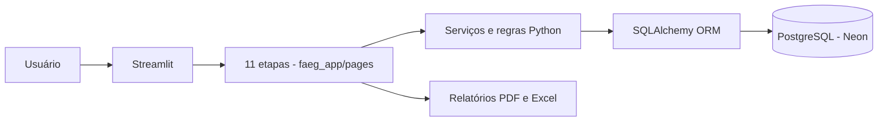

# FAEG — Sistema Web de Gestão Logística

**Projeto de desenvolvimento de software — Startup Challenge UMC 2026**
**Aplicação prática:** FAEG — Soluções Empresariais e Logísticas

O FAEG é um sistema web de gestão operacional e financeira de transportes desenvolvido a partir das necessidades da operação logística da empresa. O projeto evoluiu de uma planilha de controle de viagens para um **MVP em Python e Streamlit**, com persistência em **PostgreSQL (Neon)**.

O sistema organiza fretes individuais e ciclos com múltiplos serviços, clientes, coletas, entregas, receitas, recebimentos, despesas, abastecimentos, quilometragem, consultas e relatórios.

## Problema e solução

Na operação de transporte, um mesmo percurso pode envolver vários fretes negociados separadamente. O controle em planilhas dificulta consolidar os quilômetros e custos compartilhados sem duplicidade, acompanhar pagamentos e consultar os resultados de cada operação.

O FAEG centraliza esses registros, separando a **negociação comercial de cada frete** da **execução física da operação**. O fechamento gerencial consolida receitas e despesas do ciclo sem atribuir arbitrariamente custos comuns aos contratos individuais.

## Funcionalidades do MVP

| Etapa | Funcionalidade |
| --- | --- |
| 1 | Frota, motorista e identificação da viagem |
| 2 | Frete, carga, rota e documentos |
| 3 | Cliente contratante |
| 4 | Negociação, previsão de pagamento e recebimentos efetivos |
| 5 | Coleta e origem |
| 6 | Entrega e destino |
| 7 | Despesas de frete, ciclo ou veículo; registro de abastecimentos |
| 8 | Saídas operacionais, trechos, KM planejado e real, fechamento |
| 9 | Relatórios financeiros e operacionais; exportações |
| 10 | Consultas e histórico |
| 11 | Cadastros auxiliares |

**Conceitos principais:** um *frete* representa uma contratação comercial; um *ciclo operacional* reúne fretes e custos compartilhados; uma *saída operacional* registra o deslocamento do veículo; e um *trecho* detalha parte desse percurso. O combustível comprado é registrado uma única vez, enquanto o consumo calculado por KM permanece como indicador gerencial estimado.

## Tecnologias

| Área | Tecnologia |
| --- | --- |
| Interface | Python e Streamlit |
| Persistência | SQLAlchemy ORM |
| Banco de dados | PostgreSQL (Neon) |
| Tratamento e exportação de dados | Pandas, OpenPyXL e geração de PDF |
| Testes automatizados | Pytest |
| Versionamento e integração contínua | Git, GitHub e GitHub Actions |

A aplicação utiliza 18 modelos de tabelas e uma arquitetura modular, com as 11 etapas distribuídas em `faeg_app/pages/`.



Detalhes: [arquitetura da aplicação](docs/arquitetura_aplicacao.md), [modelo de dados](docs/arquitetura_banco.md) e [diagramas UML](docs/diagramas/README.md).

## Documentação acadêmica e técnica

| Material | Acesso |
| --- | --- |
| Visão do produto e regras operacionais | [Resumo do projeto](docs/resumo_faeg.md) · [Regras de negócio](docs/regras_negocio.md) |
| Requisitos e rastreabilidade | [Requisitos](docs/requisitos.md) · [Rastreabilidade](docs/rastreabilidade.md) |
| Modelagem | [Diagramas UML e de arquitetura](docs/diagramas/README.md) |
| Arquitetura | [Aplicação](docs/arquitetura_aplicacao.md) · [Banco de dados](docs/arquitetura_banco.md) |
| Evolução do projeto | [Reuniões](docs/reunioes/) · [Protótipo inicial](docs/prototipo/prototipo_inicial.html) · [Decisões técnicas](docs/decisoes/README.md) |
| Desenvolvimento | [Guia de execução](docs/guia_execucao.md) · [Plano de testes](docs/plano_testes.md) · [Evolução técnica](docs/planejamento_tecnico.md) |
| Apresentação acadêmica | [Guia do projeto para avaliação](docs/guia_avaliacao_banca.md) |

O índice geral está disponível em [`docs/README.md`](docs/README.md).

## Execução local

**Requisitos:** Python 3.11+, Git e banco PostgreSQL com credenciais próprias. A variável `DATABASE_URL` deve apontar para um ambiente autorizado.

```powershell
python -m venv .venv
.\.venv\Scripts\Activate.ps1
python -m pip install -r requirements.txt
Copy-Item .env.example .env
# Configurar DATABASE_URL no arquivo .env local
python -m streamlit run app.py
```

O arquivo `.env` não deve ser publicado. A inicialização do aplicativo pode sincronizar tabelas e colunas; ambientes de desenvolvimento devem utilizar banco isolado. Procedimentos completos: [guia de execução](docs/guia_execucao.md).

## Testes automatizados

```powershell
python -m pip install pytest
python -m compileall -q app.py faeg_app database views tests
python -m pytest -q tests
```

A suíte inclui testes de regras de saídas e quilômetros, estrutura modular, exportações e consistência documental. A execução automática está configurada em [GitHub Actions](.github/workflows/ci.yml). Os cenários funcionais e critérios de aceite estão documentados em [plano de testes](docs/plano_testes.md).

## Escopo e evolução

O MVP contempla o controle operacional e o fechamento **gerencial**. A importação de planilhas utiliza prévia e conferência, sem gravação automática em lote. Custos compartilhados não são rateados entre fretes individuais; o consumo estimado de combustível não constitui lançamento adicional na DRE.

**Evoluções previstas:** autenticação e permissões próprias por usuário, migrações versionadas de banco, aprimoramento dos testes integrados e conciliação financeira. O acesso à implantação e aos dados operacionais deve ser administrado pelos responsáveis pelo ambiente.

## Equipe e licenciamento

- **Felipe Pontes:** desenvolvimento de software.
- **Larissa do Espírito Santo:** desenvolvimento de software.
- **Eduardo Pontes:** representante da FAEG, levantamento operacional e validação das regras de negócio.

**Licenciamento:** direitos reservados para novas contribuições, respeitando as permissões concedidas às versões anteriormente disponibilizadas sob MIT. Consulte [`LICENSE`](LICENSE) e [`docs/licenciamento.md`](docs/licenciamento.md).
