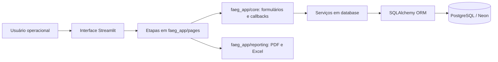

# FAEG — Sistema Web de Gestão Logística

**FAEG — Soluções Empresariais e Logísticas** · Projeto acadêmico aplicado à operação real de transporte de cargas · Startup Challenge UMC 2026.

Aplicação web para cadastrar fretes, agrupar serviços em ciclos operacionais, controlar receitas e despesas, acompanhar deslocamentos e emitir consultas e relatórios gerenciais. O projeto evoluiu de uma planilha de controle de viagens para um MVP em **Python/Streamlit**, com persistência em **PostgreSQL (Neon)**.

> **MVP em execução:** interface Streamlit com fretes individuais e ciclos, consultas, despesas, saídas e fechamento. O preenchimento de KM/odômetros ocorre na Etapa 2; o fechamento da Etapa 8 utiliza esses dados sem digitá-los novamente. Os rascunhos permitem retomar registros incompletos.

## Visão geral

- **Frete:** serviço comercial individual, com cliente, carga, documentos, negociação e recebimentos próprios.
- **Ciclo operacional:** agrupa um ou mais fretes; consolida receitas e despesas compartilhadas sem rateio automático.
- **Saída operacional:** deslocamento físico com veículo, datas, KM planejado e leituras de odômetro; um ciclo pode ter várias saídas.
- **Trecho:** etapa de uma saída, por exemplo base → coleta → entrega → retorno. Se houver trechos, o KM planejado é a soma dos trechos, sem duplicar o KM manual da saída.
- **Abastecimento:** compra efetiva de Diesel/ARLA registrada uma vez; o consumo por KM é uma **estimativa gerencial separada** da DRE.

### As 11 etapas da aplicação

| Etapas | Atividades |
| --- | --- |
| 1–3 | Frota/viagem, frete/documentos, **saídas e KM/odômetros na Etapa 2**, cliente contratante |
| 4–6 | Negociação/recebimentos, coleta e entrega |
| 7 | Despesas de frete/ciclo/veículo e histórico de abastecimentos |
| 8 | Consulta do KM consolidado, situação operacional e fechamento, sem repetir os lançamentos da Etapa 2 |
| 9 | Relatórios, indicadores, conferência financeira e exportações |
| 10–11 | Consultas gerais e cadastros, incluindo parâmetros de consumo no cadastro dos veículos |

## Tecnologias e arquitetura

| Camada | Tecnologias | Arquivos principais |
| --- | --- | --- |
| Interface web | Python, Streamlit | [`app.py`](app.py), [`faeg_app/pages/`](faeg_app/pages/), [`views/`](views/) |
| Lógica compartilhada e callbacks | Python | [`faeg_app/core.py`](faeg_app/core.py) |
| Regras, dados e serviços | Python | [`database/`](database/) |
| Persistência | SQLAlchemy ORM | [`database/models.py`](database/models.py) |
| Banco relacional | PostgreSQL — Neon | Configurado por `DATABASE_URL` |
| Dados e exportações | Pandas, OpenPyXL, geração PDF | [`faeg_app/reporting.py`](faeg_app/reporting.py) e módulos de importação |
| Testes automatizados | Pytest + SQLite em memória | [`tests/`](tests/) |



O `app.py` é o ponto de entrada da aplicação. As 11 etapas estão em `faeg_app/pages/`, as consultas/callbacks compartilhadas em `faeg_app/core.py`, a identidade visual em `faeg_app/theme.py` e os relatórios em `faeg_app/reporting.py`. Detalhes: [estrutura de módulos](docs/arquitetura_aplicacao.md).

A arquitetura do MVP **não utiliza API REST independente**: a interface chama diretamente funções Python e sessões SQLAlchemy. O modelo atual possui **19 tabelas ORM**, incluindo rascunhos de preenchimento. Consulte os [diagramas técnicos](docs/diagramas/README.md) e o [inventário do banco](docs/arquitetura_banco.md).

**MVP:** [Sistema Web FAEG](https://testefaeg.streamlit.app/) (acesso conforme a configuração da implantação).

## Executar localmente

**Pré-requisitos:** Python 3.11 ou superior recomendado, Git, acesso autorizado a um banco de **teste** PostgreSQL e credenciais próprias. Não compartilhe a `DATABASE_URL`.

```powershell
# Na pasta do repositório (PowerShell)
python -m venv .venv
.\.venv\Scripts\Activate.ps1
python -m pip install -r requirements.txt
Copy-Item .env.example .env
# Edite .env e configure DATABASE_URL para um banco DE TESTES.
python -m streamlit run app.py
```

Em Linux/macOS, ative o ambiente com `source .venv/bin/activate` e use `cp .env.example .env`.

**Atenção ao banco:** `app.py` executa `sincronizar_colunas_banco()` ao iniciar e pode **criar tabelas ou adicionar colunas**. Use primeiro uma branch isolada do Neon ou PostgreSQL de teste; faça backup antes de qualquer mudança em produção. **Não execute o aplicativo local apontando acidentalmente para a base produtiva.** Mais informações: [instalação e operação](docs/guia_execucao.md).

## Testes de desenvolvimento

```powershell
python -m pip install pytest
python -m compileall -q app.py faeg_app database views tests
python -m pytest -q tests
```

Os testes automatizados exercitam a estrutura de saídas, a conversão dos rascunhos em fretes, o lançamento financeiro único, os relatórios e a renderização simulada das 11 etapas, em **SQLite local** e sem acesso ao Neon. A rotina de CI em [`.github/workflows/ci.yml`](.github/workflows/ci.yml) executa essas verificações em pushes e pull requests; **não** certifica integração completa com o PostgreSQL. Consulte o [plano de testes](docs/plano_testes.md).

## Documentação do projeto

O [índice da documentação](docs/README.md) organiza os materiais técnicos e acadêmicos. Para o usuário operacional, consulte o [guia de preenchimento](docs/guia_preenchimento_operacional.md). Materiais principais:

- [Requisitos funcionais e critérios de aceite](docs/requisitos.md) · [Regras de negócio](docs/regras_negocio.md)
- [Arquitetura da aplicação](docs/arquitetura_aplicacao.md) · [Arquitetura e modelo de dados](docs/arquitetura_banco.md) · [Diagramas UML e de arquitetura](docs/diagramas/README.md)
- [Plano de testes](docs/plano_testes.md) · [Matriz de rastreabilidade](docs/rastreabilidade.md) · [Planejamento técnico](docs/planejamento_tecnico.md)
- [Histórico das reuniões](docs/reunioes/) · [Protótipo inicial](docs/prototipo/prototipo_inicial.html)
- [Registro de decisões técnicas](docs/decisoes/README.md) · [Histórico de versões](CHANGELOG.md)

## Limitações e próximos passos

- A autenticação e autorização individual por perfil ainda não integram o MVP. O acesso é controlado no ambiente de implantação e pelas credenciais autorizadas.
- A sincronização automática do esquema deve evoluir para migrações versionadas após planejamento.
- Não há rateio aprovado de custos compartilhados; **saldo comercial por frete de um ciclo não representa lucro individual**.
- O consumo de Diesel por KM é estimativo e **não substitui** a conciliação do combustível comprado e consumido.
- Importação Excel: existem prévia e auditoria; a gravação automática permanece bloqueada.
- O planejamento técnico inclui ampliação dos testes integrados, validação da restauração de backups e migrações versionadas.

## Equipe e licença

- **Felipe Pontes:** desenvolvimento de software.
- **Larissa do Espírito Santo:** desenvolvimento de software.
- **Eduardo Pontes:** cliente/representante da FAEG, regras operacionais e validação do negócio.

**Licenciamento:** política de [direitos reservados para novas contribuições](LICENSE), **respeitando a MIT das versões anteriores**. Consulte o [histórico de licenciamento](docs/licenciamento.md) e a [MIT previamente publicada](licenses/MIT-VERSOES-ANTERIORES.txt). A marca e os dados institucionais da FAEG não são abrangidos por autorização de uso do código.
