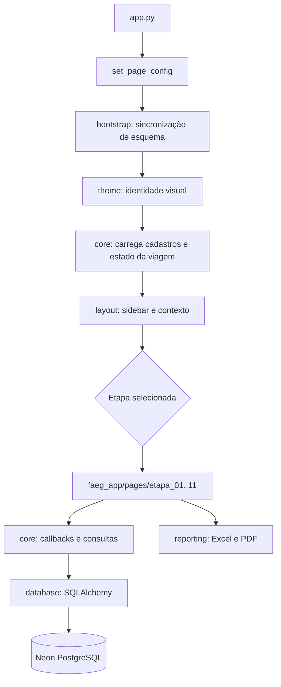

# Arquitetura de módulos — FAEG

**Estado:** refatoração conservadora sobre o código do Ajuste 27. A separação de arquivos não altera tabelas, fórmulas, identificadores, contratos, despesas ou rotas.

## Organização

```text
app.py                         # Entrada Streamlit e roteamento das 11 etapas
faeg_app/
  bootstrap.py                 # Sincronização de esquema já existente
  context.py                   # Contexto de apresentação das etapas
  core.py                      # Consultas, callbacks, estado e salvamento anteriores
  layout.py                    # Menu lateral e barra de contexto
  reporting.py                 # Exportação Excel e geração PDF
  theme.py                     # Carregamento do CSS/HTML institucional
  pages/
    etapa_01_frota.py
    etapa_02_frete_documentos.py
    etapa_03_cliente.py
    etapa_04_negociacao_recebimentos.py
    etapa_05_coleta.py
    etapa_06_entrega.py
    etapa_07_despesas.py
    etapa_08_fechamento.py
    etapa_09_relatorios.py
    etapa_10_consultas.py
    etapa_11_cadastros.py
assets/faeg_styles.html         # Conteúdo visual idêntico ao que estava em app.py
database/                       # ORM, transações, cálculos e serviços de domínio existentes
views/                          # Componente existente das saídas operacionais
tests/                          # Testes SQLite e verificações de modularização
```

## Fluxo de execução



## Cuidados de compatibilidade

1. O arquivo `app.py` **deve continuar na raiz** para que o comando `streamlit run app.py` permaneça válido.
2. A pasta inteira `faeg_app/` e `assets/faeg_styles.html` são necessárias. Publicar apenas `app.py` causará erro de importação.
3. `PageContext` transporta as listas de cadastro e os rótulos da barra de contexto para a etapa ativa; os campos editáveis e validações originais continuam usando `st.session_state`.
4. `faeg_app/core.py` preserva os nomes e assinaturas das funções existentes. Sua divisão adicional por serviços deverá ser incremental e coberta por testes de integração no PostgreSQL.
5. `faeg_app/reporting.py` mantém os geradores de PDF e Excel. O caminho do logotipo foi ajustado para continuar encontrando a imagem na raiz do projeto (`assets/logo_faeg.png`).
6. `bootstrap.py` chama a mesma rotina `sincronizar_colunas_banco()` com a mesma chave de cache (`schema_v=13`). **Não há migração de esquema nova nesta entrega**; a rotina antiga ainda pode executar DDL ao iniciar.
7. Nenhum arquivo do `database/`, `views/` ou `.streamlit/` é modificado nesta refatoração.

## Riscos e validação

Os corpos das 11 etapas foram transpostos sem alterações semânticas (comparação da árvore sintática Python). O HTML/CSS institucional foi preservado. Verificações locais incluem imports isolados, sintaxe, seis testes operacionais SQLite, geração de PDF/Excel e **simulação das 11 etapas com dublê de Streamlit** usando SQLite. Essa simulação identifica exceções básicas e não substitui a renderização no Streamlit verdadeiro.

**Limitação:** essas verificações não substituem teste de navegação no Streamlit com PostgreSQL/Neon. Validar em branch de segurança, antes do push de produção: carregar frete existente, salvar/consultar, receitas, despesas, saídas, DRE, PDF/Excel e logo. Não executar testes de escrita no banco de produção.

## Próximas melhorias (fora desta entrega)

- Separar gradualmente `core.py` em repositórios e serviços com interfaces estáveis.
- Adicionar testes de integração PostgreSQL e testes de interface com `streamlit.testing`.
- Implementar autenticação e perfis de acesso; adicionar migrações versionadas.
- Configurar validação automatizada de estilo/typing após estabilização das dependências.
