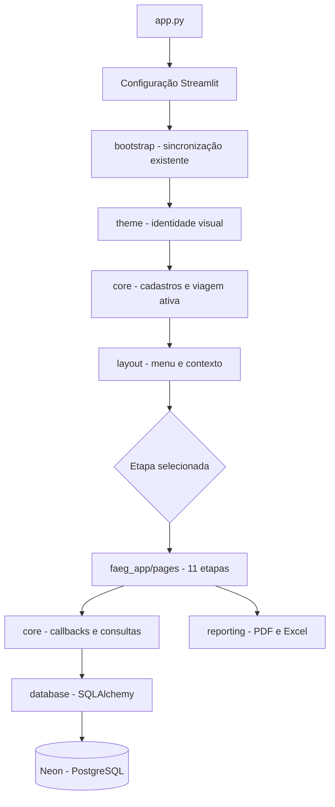

# Arquitetura de módulos — FAEG

A organização modular separa interface, regras, persistência e relatórios, preservando o fluxo das 11 etapas.

## Organização

```text
app.py                         # Entrada Streamlit e roteamento das 11 etapas
faeg_app/
  bootstrap.py                 # Sincronização de esquema
  context.py                   # Contexto de apresentação das etapas
  core.py                      # Consultas, callbacks, estado e salvamento
  layout.py                    # Menu lateral e barra de contexto
  reporting.py                 # Exportação Excel e geração PDF
  theme.py                     # Carregamento do CSS/HTML institucional
  pages/
    etapa_01_frota.py
    etapa_02_frete_documentos.py
    etapa_03_cliente.py
    etapa_04_negociacao_recebimentos.py
    etapa_05_coleta.py
    etapa_06_entrega.py
    etapa_07_despesas.py
    etapa_08_fechamento.py
    etapa_09_relatorios.py
    etapa_10_consultas.py
    etapa_11_cadastros.py
assets/faeg_styles.html         # Estilos institucionais e componentes visuais
database/                       # ORM, transações, cálculos e serviços de domínio existentes
views/                          # Componentes operacionais reutilizáveis
tests/                          # Testes SQLite e verificações de modularização
```

## Fluxo de execução



## Cuidados de compatibilidade

1. O arquivo `app.py` **deve continuar na raiz** para que o comando `streamlit run app.py` permaneça válido.
2. A pasta inteira `faeg_app/` e `assets/faeg_styles.html` são necessárias. Publicar apenas `app.py` causará erro de importação.
3. `PageContext` transporta as listas de cadastro e os rótulos da barra de contexto para a etapa ativa; os campos editáveis e validações originais continuam usando `st.session_state`.
4. `faeg_app/core.py` reúne consultas e funções compartilhadas pelas etapas. Sua divisão adicional por serviços deverá ser incremental e coberta por testes de integração no PostgreSQL.
5. `faeg_app/reporting.py` mantém os geradores de PDF e Excel. O caminho do logotipo foi ajustado para continuar encontrando a imagem na raiz do projeto (`assets/logo_faeg.png`).
6. `bootstrap.py` chama a mesma rotina `sincronizar_colunas_banco()` com a chave de cache atual (`schema_v=14`). A rotina ainda pode executar comandos DDL ao iniciar; ela não representa um sistema de migrações versionadas.
7. Os módulos de banco, a visualização de saídas e as configurações do Streamlit permanecem em suas pastas específicas.

## Qualidade e manutenção

A suíte de testes automatizados contempla regras de quilometragem, estrutura dos módulos, imports, relatórios e fluxos simulados de interface. A integração contínua executa os testes a cada atualização do código. O desenvolvimento utiliza ambientes isolados para alterações estruturais e cenários de escrita.

## Evolução da arquitetura

- Separar gradualmente `core.py` em repositórios e serviços com interfaces estáveis.
- Adicionar testes de integração PostgreSQL e testes de interface com `streamlit.testing`.
- Implementar autenticação e perfis de acesso; adicionar migrações versionadas.
- Configurar validação automatizada de estilo/typing após estabilização das dependências.
