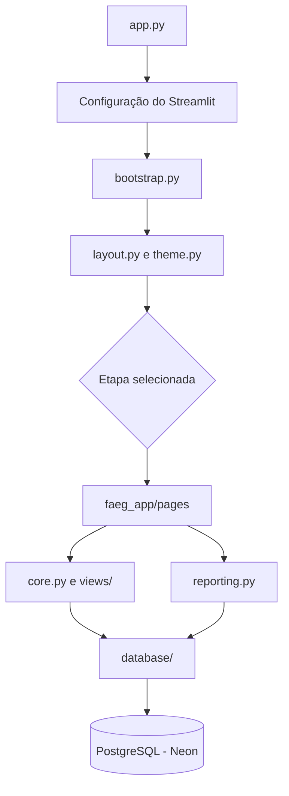

# Arquitetura da aplicação

A aplicação possui interface Streamlit modularizada, funções de domínio em Python e persistência SQLAlchemy/PostgreSQL. O ponto de entrada é `app.py`.

## Organização dos componentes

```text
app.py                           Entrada e roteamento das 11 etapas
faeg_app/
  bootstrap.py                   Preparação do banco e recursos de execução
  context.py                     Contexto de dados compartilhado entre telas
  core.py                        Operações, consultas e estado da aplicação
  layout.py                      Navegação e cabeçalho
  reporting.py                   Relatórios PDF e Excel
  theme.py                       Identidade visual
  erros.py                       Tratamento de erros de interface
  rascunhos_ui.py                Salvamento e retomada de rascunhos
  pages/                         Interface das 11 etapas
database/                         Modelos, regras transacionais e persistência
views/                            Componentes de percurso e consumo
assets/                           Estilos e logotipo
tests/                            Testes automatizados
```

## Fluxo de execução



O Streamlit processa as interações da interface e acessa o banco por sessões SQLAlchemy. Não existe API REST intermediária.

## Persistência e estado

`faeg_app/core.py` concentra consultas, callbacks, validações e funções de salvamento compartilhadas pelas etapas. `PageContext` organiza dados de apresentação; os formulários utilizam o estado de sessão do Streamlit.

A rotina `sincronizar_colunas_banco()` é executada na preparação da aplicação e mantém a compatibilidade com as estruturas existentes. O controle do esquema ainda utiliza sincronização na inicialização, sem migrações versionadas.

## Manutenção

A interface permanece organizada em 11 módulos, um por etapa. Os serviços de percurso, abastecimentos, despesas, recebimentos e relatórios possuem arquivos específicos. A suíte em `tests/` cobre comportamentos operacionais e a integridade da estrutura modular.

Os relacionamentos entre entidades estão documentados em [modelo de dados](arquitetura_banco.md) e [diagramas](diagramas/README.md).
