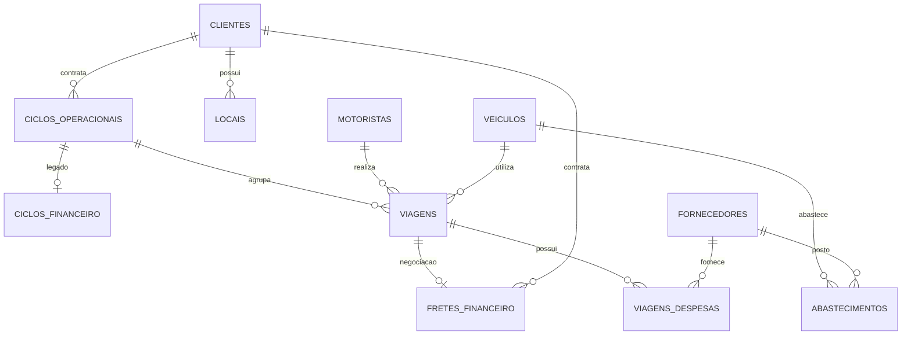

# Arquitetura do Banco de Dados — FAEG

**Fonte:** revisão do código preparada em novembro de 2026, incluindo a separação financeira por frete. **Esta estrutura ainda não foi validada nem aplicada ao PostgreSQL em uso.**

## 1. Arquitetura atual

O Streamlit (`app.py`) acessa o PostgreSQL por sessões SQLAlchemy criadas em `database/connection.py`. Os modelos são definidos em `database/models.py`; o importador lê arquivos Excel por `database/importador_planilha.py`.

### Tabelas no mapeamento ORM proposto (11 no total)

| Tabela | Chave primária | Finalidade e vínculo principal |
| --- | --- | --- |
| `motoristas` | `id_motorista` | Cadastro de motoristas, incluindo CPF e CNH |
| `veiculos` | `id_veiculo` | Cadastro de veículo, placa e RENAVAM |
| `clientes` | `id_cliente` | Contratantes, documentos e contatos |
| `locais` | `id_local` | Endereços de coleta/entrega; `id_cliente` é opcional |
| `fornecedores` | `id_fornecedor` | Postos e prestadores de serviço |
| `ciclos_operacionais` | `id_ciclo` | Nome, cliente de referência, datas, status e `km_deslocamentos_operacionais` (único por ciclo) |
| `ciclos_financeiro` | `id_ciclo` (também FK) | Valores legados do ciclo; mantidos para compatibilidade histórica |
| `viagens` | `id_viagem` | Frete/viagem com código, motorista, veículo, rota e documentos; `id_ciclo` pode ser compartilhado |
| `fretes_financeiro` | `id_viagem` (também FK) | **Nova tabela** com cliente, negociação, percentuais e parcelas específicos do frete |
| `viagens_despesas` | `id_despesa` | Despesa financeira ligada a `id_viagem`; fornecedor e campo legado `odometro_abastecimento` são opcionais |
| `abastecimentos` | `id_abastecimento` | Histórico de Diesel/ARLA por `id_veiculo`, sem depender de `id_viagem`; data, tipo, odômetro opcional, litros, preço e total |

### Relacionamentos definidos

Cada viagem possui ainda duas referências a `locais`, uma para coleta e outra para entrega.

## 2. Correções incluídas nesta etapa de código

Nesta proposta, a tela de cadastro passa a funcionar da seguinte maneira:

1. Ao salvar uma nova viagem do tipo **Ciclo**, procura um `CicloOperacional` pelo número digitado (sem distinguir maiúsculas/minúsculas e espaços nas extremidades). Se o ciclo já existir, o novo frete é vinculado a ele.
2. Os dados do contratante, valor negociado, adiantamento e saldo passam a ser armazenados por viagem em `fretes_financeiro`, permitindo **vários clientes no mesmo ciclo**.
3. Ao editar um frete de um ciclo compartilhado, seus dados financeiros e seu cliente são alterados de maneira independente; mudar o número do ciclo transfere apenas aquele frete para o outro grupo.
4. Registros históricos ainda sem linha em `fretes_financeiro` continuam sendo exibidos a partir de `ciclos_financeiro` e do cliente do ciclo. O histórico **não é migrado nem reagrupado automaticamente**.
5. A prévia da planilha identifica linhas de frete, de fechamento, ciclos com vários fretes e ciclos com vários clientes. A rotina `database/conciliacao_planilha.py` audita separadamente os fechamentos: compara os valores com os fretes anteriores, sinaliza IDs ausentes/divergentes, distingue possíveis totais gerais e destaca fretes ainda sem fechamento. A **gravação Excel permanece bloqueada**.
6. O cálculo da Etapa 8 soma `viagens.km_rota_planejado` de todos os fretes do ciclo, sem duplicar o frete aberto para edição, e acrescenta **uma única vez** `ciclos_operacionais.km_deslocamentos_operacionais`. O odômetro inicial/final continua separado da quilometragem planejada.
7. O histórico de abastecimentos agora reside na **nova tabela `abastecimentos`**, usando a placa/veículo como referência, sem FK para frete. Pode ser preenchido sem nenhuma viagem cadastrada. O registro de Diesel ou ARLA na Etapa 7 gera dados operacionais e não cria despesa de viagem automaticamente. Quando houver despesa financeira atribuída a frete, ela continua na tabela `viagens_despesas`, contabilizada apenas uma vez no DRE. O campo legado `viagens_despesas.odometro_abastecimento` permanece por compatibilidade, mas os novos odômetros são registrados em `abastecimentos`.
8. A Etapa 7 mostra distância entre dois abastecimentos de Diesel consecutivos e indicadores aproximados de KM/L e R$/KM, quando as leituras são válidas. A Etapa 8 apresenta o último indicador disponível do veículo, além de diferença e desvio entre KM real e planejado quando os dois odômetros da operação estão informados. Leituras ausentes não aparecem como zero medido.
9. O módulo `database/fechamento_ciclos.py` consolida valores somente em memória, agrupando os fretes pelo `id_ciclo` interno (sem misturar nomes legados iguais). O fechamento na Etapa 8 substitui o frete atual pelos valores não salvos; a Etapa 9 cria a visão por ciclo e a aba Excel `Fechamento_Ciclos`. Receitas negociadas e despesas por frete são somadas uma vez; parcelas previstas são mostradas separadamente dos recebimentos efetivos, ainda não implementados.
10. Quando um mesmo `ciclos_financeiro` legado serve de fonte para vários fretes sem `fretes_financeiro`, a receita legada não entra repetidamente nos totais do BI ou do ciclo. Os fretes são sinalizados como pendentes de individualização, mantendo os registros originais.

**Limitação:** ciclos duplicados já existentes na base não são mesclados; isso exige migração específica, conferência e backup. O **resumo gerencial** por ciclo foi implementado no código, mas **despesas compartilhadas independentes, rateio, recebimentos efetivos e fechamento formal com alteração de status** ainda não foram implementados.

**Critério de segurança:** a proximidade entre uma linha de fechamento e os fretes anteriores é utilizada para sugerir a correspondência na auditoria. Ela **não autoriza corrigir automaticamente** o ID do ciclo nem transferir valores ou despesas. Linhas interpretadas como total geral não são somadas como fretes adicionais.

## 3. Estrutura lógica futura (itens ainda não implementados)

| Entidade | Responsabilidade proposta |
| --- | --- |
| Códigos comerciais de frete | Identificador de negócio `F26-...` independente do `codigo_viagem` interno `V1`, `V2`... |
| Códigos únicos de ciclo | Chave de negócio única no banco, sem duplicação em acessos concorrentes |
| Vínculo frete-ciclo | `id_ciclo` opcional no frete; vários fretes podem referenciar o mesmo ciclo |
| `recebimentos` | Registro de entradas efetivas com data, valor e referência ao frete, distinto da programação de parcelas |
| `despesas` | Lançamento associado a **um frete ou a um ciclo**, com validação para evitar atribuição dupla |
| Alocação de abastecimento para DRE | Critério explícito para contabilizar e ratear custos por ciclo, sem duplicar lançamentos em `viagens_despesas` |
| Fechamento | Cálculo derivado por frete ou ciclo: receita negociada, recebida, despesas, KM estimado e KM real disponível |

Não é necessário criar todas essas tabelas imediatamente. A decisão exata do desenho deve ser validada com dados reais representativos, preservando identificadores e histórico já existentes.

### Identificadores

- **ID interno:** chave primária numérica do banco (`id_*`), sem significado comercial.
- **Código do frete:** identificador de negócio no padrão `F26-000001`.
- **Código do ciclo:** identificador de agrupamento no padrão `V26-000001`.
- **ID externo:** código de aplicativo/transportadora, quando existir, separado dos códigos internos FAEG.

Os códigos de negócio devem ser gerados e validados no banco de forma segura para acessos simultâneos; calcular o próximo número a partir de uma lista em memória pode gerar colisões.

## 4. Integridade, segurança e migração

### Estado do código proposto

- `database/models.py` usa `Base.metadata.create_all()` e comandos manuais `ALTER TABLE ... ADD COLUMN IF NOT EXISTS`. **Na primeira abertura do app alterado, `create_all()` tentará criar a nova tabela `fretes_financeiro` no banco configurado.**
- A atualização do cálculo de KM acrescenta a coluna `km_deslocamentos_operacionais` em `ciclos_operacionais` por meio de `ALTER TABLE ... ADD COLUMN IF NOT EXISTS`; essa alteração de esquema ocorre na inicialização do aplicativo atualizado.
- O controle do odômetro no abastecimento acrescenta `odometro_abastecimento INTEGER NULL` à tabela `viagens_despesas`; essa coluna também é criada automaticamente na inicialização da nova versão.
- A tabela independente `abastecimentos` (com FK para `veiculos` e fornecedor opcional) é criada por `Base.metadata.create_all()` na inicialização da versão 6. O schema existente de `viagens_despesas` não é removido nem reescrito.
- `app.py` chama `sincronizar_colunas_banco()` na inicialização.
- `database/diagnostico_ciclos.py` pode ser executado separadamente com `python -m database.diagnostico_ciclos`. Esse diagnóstico **não inicializa o app nem migra o banco**: faz exclusivamente consultas SQL em transação `READ ONLY`, identifica IDs de ciclo duplicados e diferencia os valores legados dos financeiros individuais. O resultado é exibido no terminal como JSON.
- A string de conexão é lida da variável `DATABASE_URL` após `load_dotenv()`.
- Existem restrições `unique` em alguns campos, como placas e `codigo_viagem`, e chaves estrangeiras nos relacionamentos descritos.

### Recomendações

1. **Antes de copiar este código para um ambiente conectado ao banco oficial**, realizar backup restaurável e testar em uma cópia do banco. A criação da tabela pela inicialização é uma alteração de esquema.
2. Introduzir migrações versionadas e revisáveis, por exemplo com Alembic, após planejamento técnico.
3. Criar chaves únicas específicas de frete e ciclo, índices nas chaves estrangeiras e validações para despesas e pagamentos.
4. Separar permissões de leitura e escrita; restringir acesso a dados pessoais e comerciais.
5. Registrar trilha mínima de alteração/importação e evitar exclusão física sem avaliação do histórico.
6. Substituir alterações automáticas de esquema na abertura de cada sessão por um processo controlado de atualização.

## 5. Verificações necessárias com banco de testes

- [ ] Conferir se a estrutura física hospedada corresponde aos modelos ORM.
- [ ] Executar `python -m database.diagnostico_ciclos` usando primeiro o `DATABASE_URL` do banco de testes e revisar o resultado.
- [ ] Validar criação de `fretes_financeiro` em PostgreSQL de testes, sem tocar o banco oficial.
- [ ] Validar criação de `abastecimentos`, cadastro com zero fretes e histórico do mesmo veículo com Diesel, ARLA, leituras ausentes e registros fora da ordem cronológica.
- [ ] Conferir que abastecimentos não dupliquem o DRE e que o consumo só apareça com leituras consecutivas confiáveis e tanque cheio.
- [ ] Testar edição de dois fretes com clientes diferentes dentro do mesmo ciclo.
- [ ] Contar ciclos e fretes importados e identificar ciclos duplicados pelo nome.
- [ ] Verificar se já existem códigos `V1`, `V2` etc. vinculados a fretes históricos.
- [ ] Conciliar receitas, despesas e linhas de fechamento com o Excel.
- [ ] Conferir um ciclo de três fretes com clientes e despesas distintas; a receita e os custos devem corresponder à soma individual sem duplicação.
- [ ] Conferir prévia da Etapa 8 antes de salvar o frete editado e resumo da Etapa 9 depois de salvar.
- [ ] Conferir que ciclo legado com vários fretes e um mesmo financeiro antigo seja sinalizado sem multiplicar o valor negociado.
- [ ] Simular migração e restauração em banco de teste antes de alterar dados reais.

Para as decisões operacionais que motivam esse redesenho, consultar [Regras de negócio](regras_negocio.md). Os requisitos, critérios de aceite e validações estão em [Requisitos](requisitos.md); a equipe deve acompanhar as alterações de código em Issues do GitHub.
