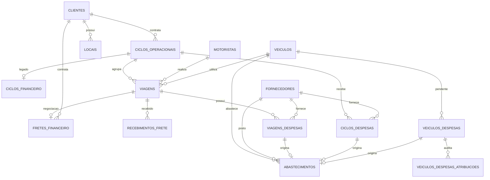

# Arquitetura do Banco de Dados — FAEG

**Fonte:** revisão do código preparada em novembro de 2026, incluindo a separação financeira por frete. **Situação:** o aplicativo já sincronizou estruturas no Neon conectado. Uma conferência inicial somente leitura identificou quinze tabelas públicas e relacionamentos; isso não substitui a homologação funcional nem a verificação integral das restrições e permissões.

## 1. Arquitetura atual

O Streamlit (`app.py`) acessa o PostgreSQL por sessões SQLAlchemy criadas em `database/connection.py`. Os modelos são definidos em `database/models.py`; o importador lê arquivos Excel por `database/importador_planilha.py`.

### Tabelas mapeadas no ORM (15 no total)

| Tabela | Chave primária | Finalidade e vínculo principal |
| --- | --- | --- |
| `motoristas` | `id_motorista` | Cadastro de motoristas, incluindo CPF e CNH |
| `veiculos` | `id_veiculo` | Cadastro de veículo, placa e RENAVAM |
| `clientes` | `id_cliente` | Contratantes, documentos e contatos |
| `locais` | `id_local` | Endereços de coleta/entrega; `id_cliente` é opcional |
| `fornecedores` | `id_fornecedor` | Postos e prestadores de serviço |
| `ciclos_operacionais` | `id_ciclo` | Nome, cliente de referência, datas, status, total `km_deslocamentos_operacionais` e componentes opcionais `km_saida_entre_coletas` e `km_retorno_operacional` (únicos por ciclo) |
| `ciclos_financeiro` | `id_ciclo` (também FK) | Valores legados do ciclo; mantidos para compatibilidade histórica |
| `viagens` | `id_viagem` | Frete/viagem com código, motorista, veículo, rota e documentos; `id_ciclo` pode ser compartilhado |
| `fretes_financeiro` | `id_viagem` (também FK) | **Nova tabela** com cliente, negociação, percentuais e parcelas específicos do frete |
| `recebimentos_frete` | `id_recebimento` | Pagamentos efetivos, cada um associado a um frete via `id_viagem`, com data, valor, forma, referência e status de cancelamento |
| `viagens_despesas` | `id_despesa` | Despesa financeira ligada a `id_viagem`; fornecedor e campo legado `odometro_abastecimento` são opcionais |
| `ciclos_despesas` | `id_despesa_ciclo` | Despesa compartilhada associada uma vez ao `id_ciclo`, com fornecedor opcional e cancelamento auditável; não é distribuída por frete |
| `veiculos_despesas` | `id_despesa_veiculo` | Origem de gasto do veículo: **pendente fora dos resultados** ou atribuído a frete/ciclo (contabilizado apenas no destino), com cancelamento auditável |
| `veiculos_despesas_atribuicoes` | `id_evento` | Eventos imutáveis de atribuição/estorno com destino, data/hora e justificativa |
| `abastecimentos` | `id_abastecimento` | Visão operacional de Diesel/ARLA por veículo, criada a partir da **mesma despesa**, com vínculo à despesa de frete/ciclo/veículo, odômetro e cancelamento |

### Relacionamentos definidos

Cada viagem possui ainda duas referências a `locais`, uma para coleta e outra para entrega.

## 2. Correções incluídas nesta etapa de código

Nesta proposta, a tela de cadastro passa a funcionar da seguinte maneira:

1. Ao salvar uma nova viagem do tipo **Ciclo**, procura um `CicloOperacional` pelo número digitado (sem distinguir maiúsculas/minúsculas e espaços nas extremidades). Se o ciclo já existir, o novo frete é vinculado a ele.
2. Os dados do contratante, valor negociado, adiantamento e saldo passam a ser armazenados por viagem em `fretes_financeiro`, permitindo **vários clientes no mesmo ciclo**.
3. Ao editar um frete de um ciclo compartilhado, seus dados financeiros e seu cliente são alterados de maneira independente; mudar o número do ciclo transfere apenas aquele frete para o outro grupo.
4. Registros históricos ainda sem linha em `fretes_financeiro` continuam sendo exibidos a partir de `ciclos_financeiro` e do cliente do ciclo. O histórico **não é migrado nem reagrupado automaticamente**.
5. A prévia da planilha identifica linhas de frete, de fechamento, ciclos com vários fretes e ciclos com vários clientes. A rotina `database/conciliacao_planilha.py` audita separadamente os fechamentos: compara os valores com os fretes anteriores, sinaliza IDs ausentes/divergentes, distingue possíveis totais gerais e destaca fretes ainda sem fechamento. A **gravação Excel permanece bloqueada**.
6. O cálculo da Etapa 8 soma `viagens.km_rota_planejado` de todos os fretes do **mesmo `id_ciclo` interno**, sem duplicar o frete aberto para edição, e acrescenta **uma única vez** `ciclos_operacionais.km_deslocamentos_operacionais`, que passa a ser o total dos dois campos manuais da Etapa 2 (`km_saida_entre_coletas + km_retorno_operacional`). Ciclos históricos homônimos não são misturados; uma seleção ambígua não soma os KM dos outros ciclos e bloqueia novos vínculos automáticos até conferência. O odômetro inicial/final pode ser preenchido nas Etapas 2 ou 8 e utiliza os mesmos dois campos em `viagens`, permanecendo separado da quilometragem planejada e dos abastecimentos da Etapa 7.
7. A Etapa 7 possui **um único formulário de despesas**, inclusive para Diesel e ARLA. O usuário escolhe o dono do custo: `viagens_despesas` (ID Frete atual), `ciclos_despesas` (ID Ciclo existente) ou `veiculos_despesas` (veículo sem operação definida). Para combustível, o campo **ODÔMETRO NO ABASTECIMENTO (KM)** aparece ao lado de litros e preço, sem checkbox; `0` significa leitura não informada (`NULL`). **No mesmo salvamento**, a aplicação gera uma linha operacional em `abastecimentos` com uma única FK de origem financeira, sem segunda digitação e sem somá-la novamente no DRE. A tabela de abastecimentos mantém `id_veiculo` próprio para o consumo, independentemente de ID Frete. Dados históricos não são convertidos automaticamente.
8. A Etapa 7 mostra distância entre dois abastecimentos de Diesel consecutivos e indicadores aproximados de KM/L e R$/KM, quando as leituras são válidas. A Etapa 8 apresenta o último indicador disponível do veículo, além de diferença e desvio entre KM total real e planejado. Em ciclo, o total real só é consolidado quando todos os fretes têm odômetros válidos e não há intervalos sobrepostos no mesmo veículo; o KM real individual permanece visível no topo. Leituras ausentes não aparecem como zero medido.
9. O módulo `database/fechamento_ciclos.py` consolida valores somente em memória, agrupando os fretes pelo `id_ciclo` interno (sem misturar nomes legados iguais). O fechamento na Etapa 8 substitui o frete atual pelos valores não salvos; a Etapa 9 cria a visão por ciclo e a aba Excel `Fechamento_Ciclos`. Despesas por frete e despesas compartilhadas do ciclo são somadas uma vez cada; parcelas previstas aparecem separadas dos pagamentos registrados efetivamente.
10. Quando um mesmo `ciclos_financeiro` legado serve de fonte para vários fretes sem `fretes_financeiro`, a receita legada não entra repetidamente nos totais do BI ou do ciclo. Os fretes são sinalizados como pendentes de individualização, mantendo os registros originais.
11. A nova tabela `recebimentos_frete` conserva pagamentos efetivos por `id_viagem` com data, valor, tipo, forma e referência opcional; o histórico inclui cancelamentos com data e motivo. A Etapa 4 grava esses registros apenas depois que o frete existe. Um cancelamento lógico exclui o valor dos cálculos sem apagar a linha. A Etapa 8 e a Etapa 9 leem os recebimentos confirmados por frete e por ciclo. O Excel exporta o histórico completo em `Recebimentos_Fretes`.
12. A tabela `ciclos_despesas` guarda gastos comuns por **ID interno do ciclo**, cadastrados na Etapa 7 depois de existir um ciclo salvo. Valores ativos entram uma vez no fechamento do ciclo; cancelamentos deixam data, motivo e valor original. O Excel possui `Despesas_Ciclo` (inclusive cancelados), e `Fechamento_Ciclos` separa despesas de fretes e despesas compartilhadas. O BI filtrado por frete/cliente mantém apenas as despesas atribuídas aos fretes, pois não existe rateio aprovado.
13. A tabela `veiculos_despesas` guarda a origem de gastos do veículo: pendentes, atribuídos ou cancelados. O arquivo Excel inclui `Despesas_Veiculo`, e somente gastos **pendentes** permanecem fora do DRE/BI. A Etapa 7 permite **atribuir um gasto pendente ao ID Frete ou ID Ciclo que contenha o mesmo veículo**, com justificativa, criando apenas o lançamento financeiro no destino, sem duplicar o histórico de abastecimento. A origem não é somada novamente no DRE. É possível **estornar a atribuição**, devolvendo o custo ao estado pendente. Cada movimentação gera evento em `veiculos_despesas_atribuicoes`, exportado em `Atribuicoes_Despesas`.
14. Para não perder a trilha de auditoria, despesas de frete/ciclo provenientes de `veiculos_despesas` só podem ser corrigidas via **estorno da atribuição**. No estorno de frete, o lançamento financeiro de destino é removido e o evento preserva seu ID; no de ciclo, o lançamento é cancelado logicamente. O abastecimento operacional original segue vinculado à despesa do veículo e não é duplicado. Cancelar a própria despesa provisória só é permitido enquanto não estiver atribuída.
15. O módulo `database/fechamento_ciclos.py` também reconcilia o resultado gerencial de **toda a base salva**: receita considerada dos fretes, custos dos fretes, custos compartilhados ativos, resultado parcial, recebido de fato e saldo a receber. Gastos de veículo pendentes ficam fora do resultado; o valor de origem dos já atribuídos é apenas informativo e não entra em nova soma. Uma nova seção da Etapa 9 e a aba Excel `Conferencia_Financeira` deixam explícita essa composição. A exportação na Etapa 10 utiliza o conjunto completo de fretes/despesas/fechamentos, sem misturar fretes filtrados com despesas não filtradas. **Esta versão não cria tabelas nem altera o esquema além do que as versões anteriores já prepararam.**
16. O módulo `database/conferencia_duplicidades.py` compara despesas de frete e compartilhadas **no mesmo ID de ciclo** por data, categoria, descrição, fornecedor, quantidade, preço e valor; para combustível, utiliza veículo/odômetro quando disponíveis. Retorna **alertas**, nunca ordens de exclusão. A Etapa 7 solicita confirmação explícita se um novo lançamento se parece com custo de outro destino; a atribuição do veículo também verifica o destino cruzado e exige confirmação com justificativa quando a despesa é efetivamente distinta. A Etapa 9 e a aba Excel `Possiveis_Duplicidades` exibem indícios históricos e os IDs para conferência dos comprovantes. Nenhuma nova tabela é criada nesta etapa.
17. As Etapas 2 e 8 mantêm a decisão de Eduardo: `KM X ROTA PLANEJADO` é apenas título; os três componentes da rota são manuais na Etapa 2; `KM PLANEJADO` é soma dos fretes do mesmo ID interno; `KM DESLOCAMENTOS OPERACIONAIS` é saída/entre coletas + retorno, único por operação/ciclo; `KM TOTAL PLANEJADO` soma os componentes; `KM TOTAL REAL` e diferença dependem dos odômetros da operação preenchidos na Etapa 2. A edição valida ID Frete não reutilizado, impede troca de veículo com abastecimento ativo e bloqueia saída do último frete de ciclo com despesas compartilhadas ativas. Não há transferência automática de custos ou reagrupamento de ciclos antigos.

**Limitação:** ciclos duplicados já existentes na base não são mesclados; isso exige migração específica, conferência e backup. O **resumo gerencial**, os **recebimentos**, o **lançamento único de combustível/despesa** e a **atribuição/estorno manual de gastos do veículo** foram preparados no código. **Rateio automático, conciliação bancária, estornos externos e fechamento formal com alteração de status** não foram implementados.

**Critério de segurança:** a proximidade entre uma linha de fechamento e os fretes anteriores é utilizada para sugerir a correspondência na auditoria. Ela **não autoriza corrigir automaticamente** o ID do ciclo nem transferir valores ou despesas. Linhas interpretadas como total geral não são somadas como fretes adicionais.

## 3. Estrutura lógica futura (itens ainda não implementados)

| Entidade | Responsabilidade proposta |
| --- | --- |
| Códigos comerciais de frete | Identificador de negócio `F26-...` independente do `codigo_viagem` interno `V1`, `V2`... |
| Códigos únicos de ciclo | Chave de negócio única no banco, sem duplicação em acessos concorrentes |
| Vínculo frete-ciclo | `id_ciclo` opcional no frete; vários fretes podem referenciar o mesmo ciclo |
| Conciliação e classificação de recebimentos | Confrontar `recebimentos_frete` com extratos bancários; situações financeiras automáticas e estornos por transferência externa |
| Conferência avançada por documento fiscal | A versão atual alerta sobre custos semelhantes entre frete/ciclo; a prevenção inequívoca ainda exige identidade única de NF-e/comprovante, inclusive em origens e veículos diferentes |
| Rateio posterior de gastos compartilhados | Critério aprovado para distribuir custos de um ciclo entre seus fretes, sem duplicar lançamentos ou confundir custo direto com rateio gerencial |
| Fechamento | Cálculo derivado por frete ou ciclo: receita negociada, recebida, despesas, KM estimado e KM real disponível |

Não é necessário criar todas essas tabelas imediatamente. A decisão exata do desenho deve ser validada com dados reais representativos, preservando identificadores e histórico já existentes.

### Identificadores

- **ID interno:** chave primária numérica do banco (`id_*`), sem significado comercial.
- **Código do frete:** identificador de negócio no padrão `F26-000001`.
- **Código do ciclo:** identificador de agrupamento no padrão `V26-000001`.
- **ID externo:** código de aplicativo/transportadora, quando existir, separado dos códigos internos FAEG.

Os códigos de negócio devem ser gerados e validados no banco de forma segura para acessos simultâneos; calcular o próximo número a partir de uma lista em memória pode gerar colisões.

## 4. Integridade, segurança e migração

### Estado do código proposto

- `database/models.py` usa `Base.metadata.create_all()` e comandos manuais `ALTER TABLE ... ADD COLUMN IF NOT EXISTS`. **Na primeira abertura do app alterado, `create_all()` tentará criar a nova tabela `fretes_financeiro` no banco configurado.**
- A atualização do cálculo de KM acrescenta a coluna `km_deslocamentos_operacionais` em `ciclos_operacionais` por meio de `ALTER TABLE ... ADD COLUMN IF NOT EXISTS`; essa alteração de esquema ocorre na inicialização do aplicativo atualizado.
- O novo detalhamento da Etapa 2 adiciona **duas colunas opcionais** em `ciclos_operacionais`: `km_saida_entre_coletas` e `km_retorno_operacional` (`NUMERIC(12,2)`, inicialmente `NULL` em linhas legadas). A migração preserva o total preexistente em `km_deslocamentos_operacionais`; só uma edição explícita da composição atualiza as duas colunas e o total. A inicialização do aplicativo modificado executa os `ADD COLUMN IF NOT EXISTS` — ensaiar primeiro em cópia do PostgreSQL.
- A revisão visual da Tela 8 utiliza `schema_v=12` na chave do cache de inicialização para **não reutilizar** indevidamente a inicialização anterior de versão 11 após a inclusão dessas duas colunas. O aumento de versão não altera registros por si só; a sincronização estrutural permanece sujeita à validação prévia em banco de testes.
- O controle do odômetro no abastecimento acrescenta `odometro_abastecimento INTEGER NULL` à tabela `viagens_despesas`; essa coluna também é criada automaticamente na inicialização da nova versão.
- A tabela independente `abastecimentos` (com FK para `veiculos` e fornecedor opcional) é criada por `Base.metadata.create_all()` na inicialização da versão 6. O schema existente de `viagens_despesas` não é removido nem reescrito.
- A tabela `recebimentos_frete` é criada por `Base.metadata.create_all()` na inicialização da versão 8. Nenhuma coluna de dados históricos é removida e os recebimentos não são deduzidos automaticamente das parcelas previstas.
- A tabela `ciclos_despesas` é criada por `Base.metadata.create_all()` na inicialização da versão 9. Não redistribui custos existentes nem converte registros de abastecimento em despesas financeiras.
- A versão 10 cria `veiculos_despesas`, adiciona FKs opcionais de origem e campos de cancelamento em `abastecimentos`, e amplia a precisão do valor unitário em `viagens_despesas` e `ciclos_despesas` para quatro decimais. A inicialização altera esquema, mas **não reclassifica nem copia automaticamente os dados legados**.
- A versão 11 cria `veiculos_despesas_atribuicoes` e adiciona em `veiculos_despesas` duas FKs opcionais para o lançamento financeiro de destino e a data de atribuição. Não atribui gastos antigos automaticamente; somente ações explícitas na Etapa 7 produzem eventos.
- `app.py` chama `sincronizar_colunas_banco()` na inicialização.
- `database/diagnostico_ciclos.py` pode ser executado separadamente com `python -m database.diagnostico_ciclos`. Esse diagnóstico **não inicializa o app nem migra o banco**: faz exclusivamente consultas SQL em transação `READ ONLY`, identifica IDs de ciclo duplicados e diferencia os valores legados dos financeiros individuais. O resultado é exibido no terminal como JSON.
- A string de conexão é lida da variável `DATABASE_URL` após `load_dotenv()`.
- Existem restrições `unique` em alguns campos, como placas e `codigo_viagem`, e chaves estrangeiras nos relacionamentos descritos.

### Recomendações

1. **Antes de copiar este código para um ambiente conectado ao banco oficial**, realizar backup restaurável e testar em uma cópia do banco. A criação da tabela pela inicialização é uma alteração de esquema.
2. Introduzir migrações versionadas e revisáveis, por exemplo com Alembic, após planejamento técnico.
3. Criar chaves únicas específicas de frete e ciclo, índices nas chaves estrangeiras e validações para despesas e pagamentos.
4. Separar permissões de leitura e escrita; restringir acesso a dados pessoais e comerciais.
5. Registrar trilha mínima de alteração/importação e evitar exclusão física sem avaliação do histórico.
6. Substituir alterações automáticas de esquema na abertura de cada sessão por um processo controlado de atualização.

## 5. Verificações necessárias com banco de testes

- [ ] Conferir se a estrutura física hospedada corresponde aos modelos ORM.
- [ ] Executar `python -m database.diagnostico_ciclos` usando primeiro o `DATABASE_URL` do banco de testes e revisar o resultado.
- [ ] Validar criação de `fretes_financeiro` em PostgreSQL de testes, sem tocar o banco oficial.
- [ ] Validar criação de `abastecimentos`, cadastro com zero fretes e histórico do mesmo veículo com Diesel, ARLA, leituras ausentes e registros fora da ordem cronológica.
- [ ] Conferir que abastecimentos não dupliquem o DRE e que o consumo só apareça com leituras consecutivas confiáveis e tanque cheio.
- [ ] Validar criação de `recebimentos_frete`; registrar pagamento parcial, duas parcelas, duplicidade, excedente confirmado e cancelamento com motivo, garantindo que só valores confirmados compõem o saldo.
- [ ] Conferir consolidação dos recebimentos dos fretes do mesmo ciclo e aba `Recebimentos_Fretes` da exportação.
- [ ] Validar criação de `ciclos_despesas` e registrar uma despesa de ciclo; verificar que é somada uma vez em `Fechamento_Ciclos`, sem entrar no resultado de cada frete/cliente.
- [ ] Cancelar uma despesa de ciclo com motivo, conferir exclusão do total e permanência com situação cancelada em `Despesas_Ciclo`; checar prevenção de lançamento repetido.
- [ ] Conferir o **único formulário** da Etapa 7: Diesel/ARLA com odômetro visível, litros e preço, destino Frete/Ciclo/Veículo, sem segunda área de cadastro.
- [ ] Verificar que cada lançamento de combustível salva uma só despesa financeira e uma projeção `abastecimentos`, e que somente a primeira conta no DRE.
- [ ] Salvar gasto provisório com zero fretes, cancelar e revisar as abas `Despesas_Veiculo` e `Abastecimentos_Veiculos` sem contagem duplicada.
- [ ] Atribuir uma despesa provisória a frete salvo do mesmo veículo, conferir que ela entra só uma vez no DRE, sem segundo abastecimento.
- [ ] Atribuir a ciclo salvo do mesmo veículo, conferir que o total aparece uma vez no fechamento do ciclo, não no BI por frete.
- [ ] Estornar ambas as atribuições, verificar exclusão dos respectivos totais, retorno a pendente e eventos de auditoria preservados em `Atribuicoes_Despesas`.
- [ ] Tentar atribuir a frete de veículo diferente, atribuir duas vezes e remover diretamente um destino transferido: todas as tentativas devem ser bloqueadas.
- [ ] Conferir `Conferencia_Financeira` e a nova subaba da Etapa 9: despesas dos fretes + despesas compartilhadas = despesas contabilizadas; pendentes por veículo fora do resultado; já atribuídas não somadas novamente.
- [ ] Conferir margem indisponível sem receita ou com financeiro legado ambíguo, mesmo que existam despesas.
- [ ] Na Etapa 10, aplicar filtro de um único cliente e baixar **Base Completa**: todas as abas devem representar a base inteira, e não apenas a lista filtrada da tela.
- [ ] Lançar despesa de frete semelhante a despesa ativa no mesmo ciclo; verificar alerta cruzado e exigência de confirmação de que são comprovantes distintos.
- [ ] Repetir a tentativa inversa (novo custo do ciclo semelhante a custo de frete) e verificar consulta/Excel `Possiveis_Duplicidades` sem edição automática do histórico.
- [ ] Registrar dois abastecimentos legítimos de valores semelhantes, mas com odômetros diferentes e comprovantes distintos; conferir que o sistema não presume repetição indevida.
- [ ] Tentar atribuir uma despesa provisória a frete/ciclo que possui gasto semelhante do outro destino; exigir conferência explícita e motivo justificável.
- [ ] Repetir despesa não combustível idêntica no mesmo frete, tanto temporário quanto salvo, e conferir o bloqueio preventivo.
- [ ] Criar dois ciclos legados com nomes iguais e IDs diferentes: ao editar frete existente, conferir KM apenas de seu ID; ao tentar novo vínculo ambíguo, conferir bloqueio sem reagrupamento automático.
- [ ] Testar os campos manuais/derivados das Etapas 2 e 8 e a memória do cálculo (fretes 280+120+85 e deslocamentos 65 = total 550 km), com zero KM manual alertado.
- [ ] Tentar reutilizar o mesmo ID Frete em outro frete; verificar bloqueio sem modificar dados antigos.
- [ ] Tentar tirar o último frete de um ciclo com despesa compartilhada ativa; verificar bloqueio e permanência do vínculo financeiro anterior.
- [ ] Tentar alterar a placa de um frete com abastecimento ativo e salvar frete novo com combustível temporário de outra placa; verificar proteção do histórico por veículo.
- [ ] Simular despesa compartilhada ativa de um ciclo sem fretes do tipo Ciclo; verificar inclusão na conferência geral e aviso específico para revisão do vínculo.
- [ ] Testar edição de dois fretes com clientes diferentes dentro do mesmo ciclo.
- [ ] Contar ciclos e fretes importados e identificar ciclos duplicados pelo nome.
- [ ] Verificar se já existem códigos `V1`, `V2` etc. vinculados a fretes históricos.
- [ ] Conciliar receitas, despesas e linhas de fechamento com o Excel.
- [ ] Conferir um ciclo de três fretes com clientes e despesas distintas; a receita e os custos devem corresponder à soma individual sem duplicação.
- [ ] Conferir prévia da Etapa 8 antes de salvar o frete editado e resumo da Etapa 9 depois de salvar.
- [ ] Conferir que ciclo legado com vários fretes e um mesmo financeiro antigo seja sinalizado sem multiplicar o valor negociado.
- [ ] Simular migração e restauração em banco de teste antes de alterar dados reais.

Para as decisões operacionais que motivam esse redesenho, consultar [Regras de negócio](regras_negocio.md). Os requisitos, critérios de aceite e validações estão em [Requisitos](requisitos.md); a equipe deve acompanhar as alterações de código em Issues do GitHub.