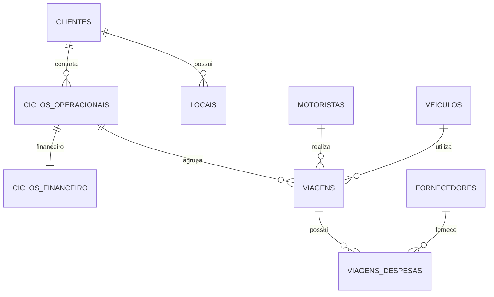

# Arquitetura do Banco de Dados — FAEG

**Fonte:** leitura dos arquivos `database/models.py`, `database/connection.py`, `database/importador_planilha.py` e `app.py` da versão recebida em novembro de 2026. Este é um retrato do código, não uma inspeção direta do banco PostgreSQL hospedado.

## 1. Arquitetura atual

O Streamlit (`app.py`) acessa o PostgreSQL por sessões SQLAlchemy criadas em `database/connection.py`. Os modelos são definidos em `database/models.py`; o importador lê arquivos Excel por `database/importador_planilha.py`.

### Tabelas existentes no mapeamento ORM

| Tabela | Chave primária | Finalidade e vínculo principal |
| --- | --- | --- |
| `motoristas` | `id_motorista` | Cadastro de motoristas, incluindo CPF e CNH |
| `veiculos` | `id_veiculo` | Cadastro de veículo, placa e RENAVAM |
| `clientes` | `id_cliente` | Contratantes, documentos e contatos |
| `locais` | `id_local` | Endereços de coleta/entrega; `id_cliente` é opcional |
| `fornecedores` | `id_fornecedor` | Postos e prestadores de serviço |
| `ciclos_operacionais` | `id_ciclo` | Nome, cliente, datas e status do ciclo |
| `ciclos_financeiro` | `id_ciclo` (também FK) | Negociação, percentuais e parcelas do ciclo; relação 1:1 |
| `viagens` | `id_viagem` | Frete/viagem com código, motorista, veículo, cliente via ciclo, rota e documentos |
| `viagens_despesas` | `id_despesa` | Despesa ligada a `id_viagem`; fornecedor é opcional |

### Relacionamentos definidos

Cada viagem possui ainda duas referências a `locais`, uma para coleta e outra para entrega.

## 2. Diferença entre o esquema e a operação desejada

Embora a relação `ciclos_operacionais` 1:N `viagens` esteja prevista no ORM, a implementação atual não a utiliza da maneira esperada para um ciclo real:

1. `app.py`, na função `salvar_viagem_completa()`, cria um `CicloOperacional` novo a cada nova viagem, sem procurar um ciclo existente com o mesmo número.
2. O importador repete a criação de ciclos por frete, mesmo quando várias linhas do Excel possuem o mesmo ID de ciclo.
3. O código do ciclo é guardado em `nome_operacao`; `status_ciclo` também é reutilizado para armazenar a string `COD::<codigo_viagem>`. Isso mistura identidade e status.
4. `ciclos_financeiro` concentra valores por ciclo, enquanto a planilha permite que cada frete de um ciclo tenha cliente e negociação específicos.
5. `viagens_despesas` só conhece `id_viagem`; não há mecanismo próprio para despesas compartilhadas do ciclo.
6. O fechamento do Excel não é representado como uma entidade ou visão consolidada separada.

**Consequência:** o modelo precisa ser ajustado *antes* de criar um fechamento financeiro confiável para vários fretes. Alterar apenas o relatório não resolve as duplicações ou os vínculos.

## 3. Estrutura lógica desejada (proposta, não implementada)

| Entidade | Responsabilidade proposta |
| --- | --- |
| `fretes` (ou evolução de `viagens`) | Um registro por serviço, com `codigo_frete` único, cliente e negociação próprios |
| `ciclos_operacionais` | Um registro por `codigo_ciclo` único, datas, veículo, estado e totalização do percurso |
| Vínculo frete-ciclo | `id_ciclo` opcional no frete; vários fretes podem referenciar o mesmo ciclo |
| `recebimentos` | Registro de entradas efetivas com data, valor e referência ao frete, distinto da programação de parcelas |
| `despesas` | Lançamento associado a **um frete ou a um ciclo**, com validação para evitar atribuição dupla |
| `abastecimentos` | Data, veículo, fornecedor, odômetro informado, litros, preço e valor; associação operacional quando aplicável |
| Fechamento | Cálculo derivado por frete ou ciclo: receita negociada, recebida, despesas, KM estimado e KM real disponível |

Não é necessário criar todas essas tabelas imediatamente. A decisão exata do desenho deve ser validada com dados reais representativos, preservando identificadores e histórico já existentes.

### Identificadores

- **ID interno:** chave primária numérica do banco (`id_*`), sem significado comercial.
- **Código do frete:** identificador de negócio no padrão `F26-000001`.
- **Código do ciclo:** identificador de agrupamento no padrão `V26-000001`.
- **ID externo:** código de aplicativo/transportadora, quando existir, separado dos códigos internos FAEG.

Os códigos de negócio devem ser gerados e validados no banco de forma segura para acessos simultâneos; calcular o próximo número a partir de uma lista em memória pode gerar colisões.

## 4. Integridade, segurança e migração

### Estado atual

- `database/models.py` usa `Base.metadata.create_all()` e comandos manuais `ALTER TABLE ... ADD COLUMN IF NOT EXISTS`.
- `app.py` chama `sincronizar_colunas_banco()` na inicialização.
- A string de conexão é lida da variável `DATABASE_URL` após `load_dotenv()`.
- Existem restrições `unique` em alguns campos, como placas e `codigo_viagem`, e chaves estrangeiras nos relacionamentos descritos.

### Recomendações

1. **Antes de qualquer migração**, realizar backup restaurável e testar em uma cópia do banco.
2. Introduzir migrações versionadas e revisáveis, por exemplo com Alembic, após planejamento técnico.
3. Criar chaves únicas específicas de frete e ciclo, índices nas chaves estrangeiras e validações para despesas e pagamentos.
4. Separar permissões de leitura e escrita; restringir acesso a dados pessoais e comerciais.
5. Registrar trilha mínima de alteração/importação e evitar exclusão física sem avaliação do histórico.
6. Substituir alterações automáticas de esquema na abertura de cada sessão por um processo controlado de atualização.

## 5. Verificações necessárias com banco de testes

- [ ] Conferir se a estrutura física hospedada corresponde aos modelos ORM.
- [ ] Contar ciclos e fretes importados e identificar ciclos duplicados pelo nome.
- [ ] Verificar se já existem códigos `V1`, `V2` etc. vinculados a fretes históricos.
- [ ] Conciliar receitas, despesas e linhas de fechamento com o Excel.
- [ ] Simular migração e restauração em banco de teste antes de alterar dados reais.

Para as decisões operacionais que motivam esse redesenho, consultar [Regras de negócio](regras_negocio.md). Os requisitos, critérios de aceite e validações estão em [Requisitos](requisitos.md); a equipe deve acompanhar as alterações de código em Issues do GitHub.