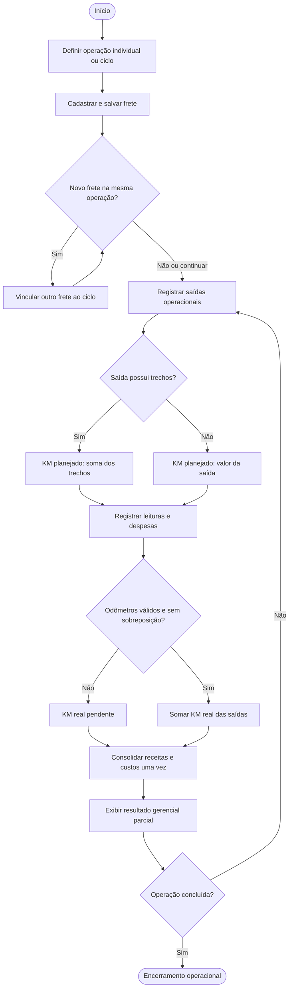

# Diagrama de atividades — ciclo, saídas e fechamento

**Modelo conceitual:** o encerramento automático do ciclo e todos os rótulos operacionais ainda dependem de validação. Os recebimentos podem permanecer pendentes após a entrega.
