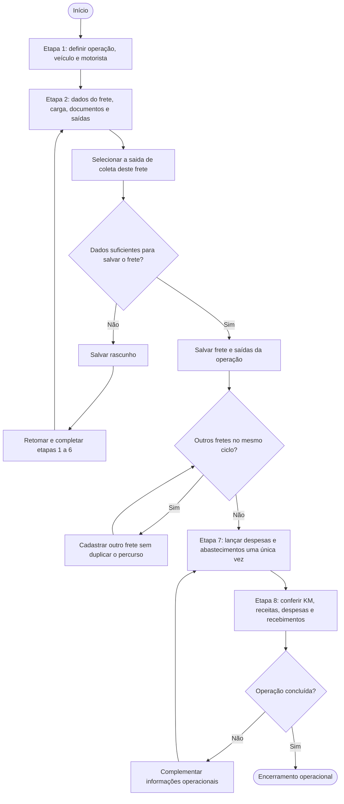

# Diagrama de atividades — preenchimento e fechamento

O processo apresenta a organização vigente das telas e os caminhos de salvamento provisório ou definitivo.

A operação individual e o ciclo utilizam o mesmo cadastro de saídas. O ciclo permite mais fretes e mais saídas preparatórias. As leituras finais de odômetro são informadas na chegada à base, na Etapa 2. Os recebimentos financeiros podem continuar em acompanhamento após a conclusão operacional.
