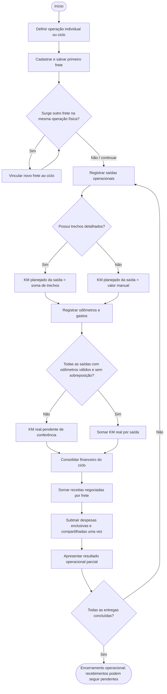

# Diagrama de atividades — operação e fechamento

A sequência mostra as decisões conceituais relevantes. O encerramento formal automático do ciclo **ainda não foi homologado** e não deve ser inferido deste diagrama.
