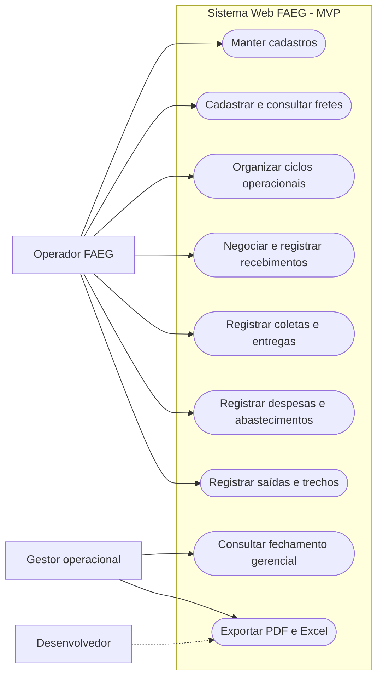

# Casos de uso — visão funcional do sistema FAEG

Notação: fluxograma funcional equivalente a casos de uso, elaborado em Mermaid para visualização no GitHub. Não utiliza os símbolos gráficos tradicionais da UML para atores e casos de uso.

A manutenção dos módulos e dos testes integra o processo de desenvolvimento. Autenticação individual, emissão fiscal automática e importação persistente de planilhas compõem o planejamento evolutivo.
