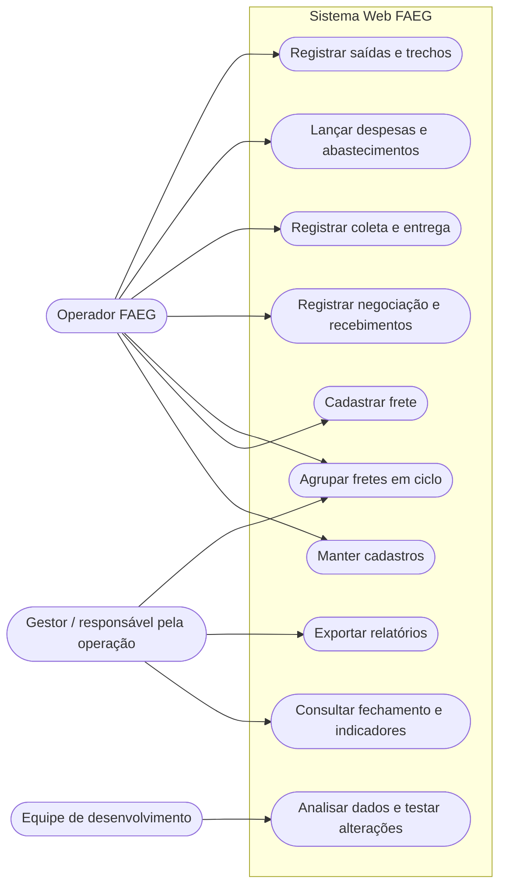

# Casos de uso do Sistema FAEG

**Tipo:** visão funcional de casos de uso, em fluxograma Mermaid. Para um diagrama UML formal de casos de uso seria necessário um renderizador específico; aqui foi priorizada a leitura diretamente pelo GitHub.

**Limite do escopo:** não estão modelados autenticação por perfil, conciliação bancária automatizada, emissão fiscal automática ou rastreamento de carga, porque tais funcionalidades não foram comprovadas no código inspecionado.
