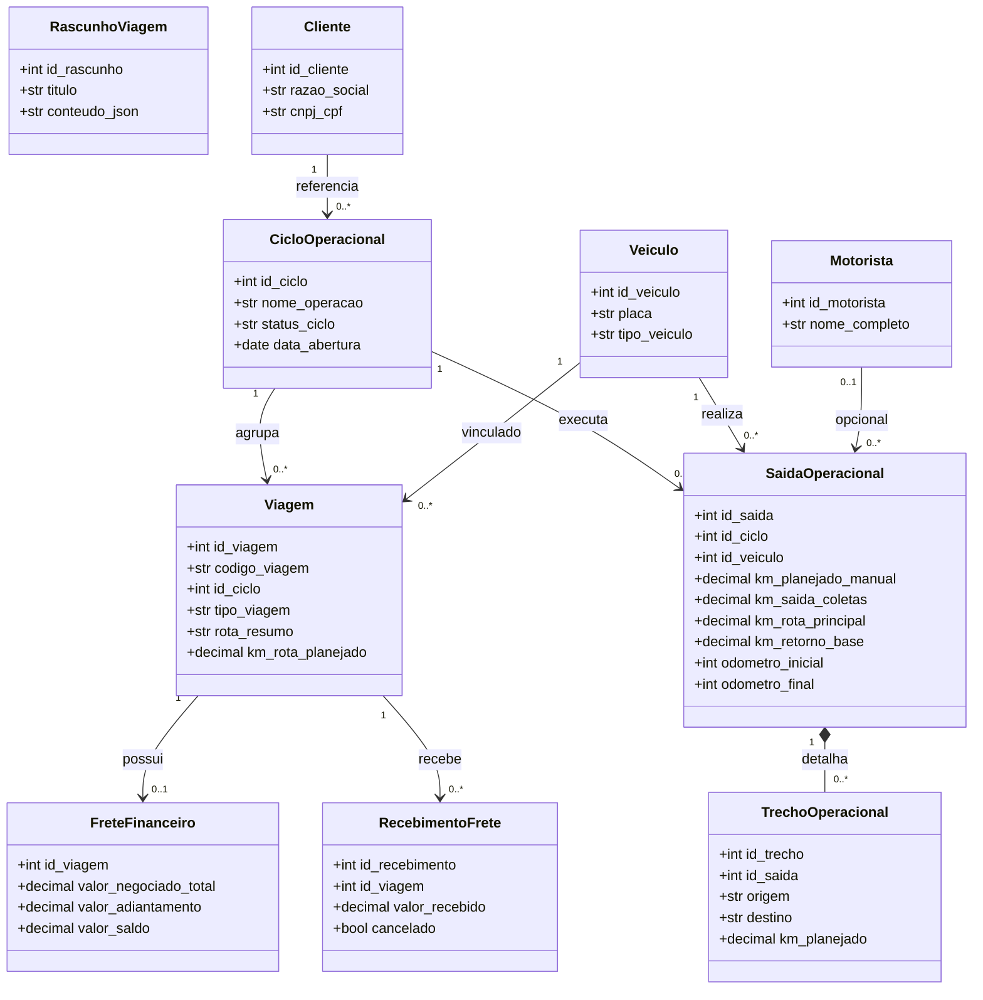
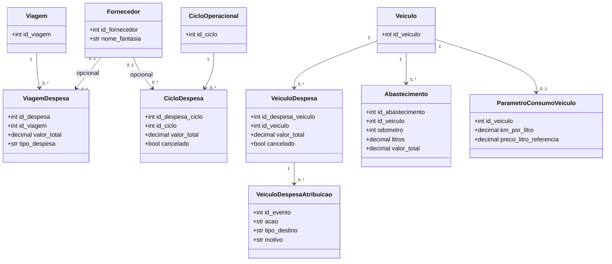

# Diagramas de classes UML — modelo de domínio

As classes abaixo são **entidades ORM reais** de [`database/models.py`](../../database/models.py). Os atributos ilustram campos relevantes; o arquivo Python é a fonte integral de tipos e restrições.

## Núcleo comercial e operacional

## Custos, abastecimentos e atribuições

**Observação:** `Abastecimento` guarda referência a **uma** despesa de origem de frete, ciclo ou veículo. Esta associação polimórfica por FKs opcionais está detalhada no [DER](entidade_relacionamento.md). Não significa um novo custo financeiro.
