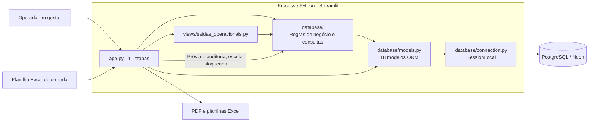

# Diagrama de componentes — arquitetura implementada

**Características reais:** o aplicativo opera como processo Streamlit com acesso ao banco via SQLAlchemy; não há camada HTTP REST independente entre `app.py` e a persistência. A geração de relatórios ocorre na aplicação. A sincronização de tabelas/colunas é chamada no início de `app.py`.

**Ponto de evolução:** separar o arquivo `app.py` (mais de 7 mil linhas na versão revisada) por páginas/serviços, mas somente com testes de regressão e sem reorganizar código produtivo nesta atualização documental.
