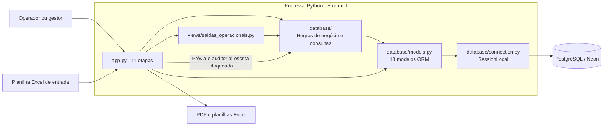
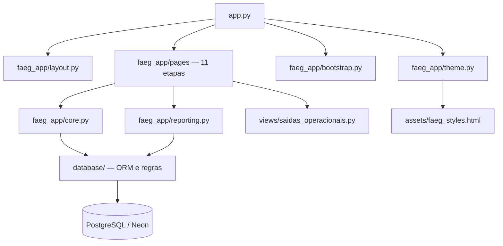

# Diagrama de componentes — arquitetura implementada

**Características reais:** o aplicativo opera como processo Streamlit com acesso ao banco via SQLAlchemy; não há camada HTTP REST independente entre `app.py` e a persistência. A geração de relatórios ocorre na aplicação. A sincronização de tabelas/colunas é chamada no início de `app.py`.

**Nota histórica:** na revisão documental anterior, `app.py` ainda tinha mais de 7 mil linhas. A modularização conservadora foi realizada posteriormente; consulte o complemento abaixo e a [arquitetura da aplicação](../arquitetura_aplicacao.md).

## Complemento — módulos após refatoração

A modularização é interna ao mesmo processo Streamlit; **não cria API REST nem novos microserviços**.
