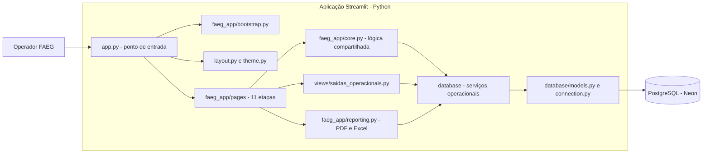

# Diagrama de componentes — arquitetura modular implementada

O projeto é um **monólito Streamlit modularizado**. `app.py` apenas inicializa e seleciona a etapa; os módulos Python compartilham a mesma aplicação e acessam o banco por SQLAlchemy. **Não existe API REST própria**, microsserviço ou autenticação por perfis implementada no código revisado.

O diretório `assets/` fornece o logotipo e o estilo visual. O importador em `database/importador_planilha.py` permite **prévia e auditoria**, não importação persistente liberada. O serviço inicializa a sincronização de esquema já existente; ela não é equivalente a um controle de migrações versionadas.

Referência de implementação: [arquitetura da aplicação](../arquitetura_aplicacao.md).
