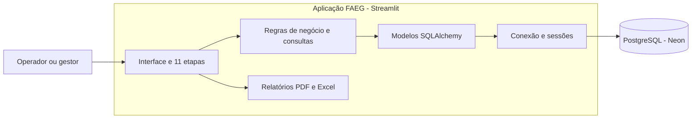
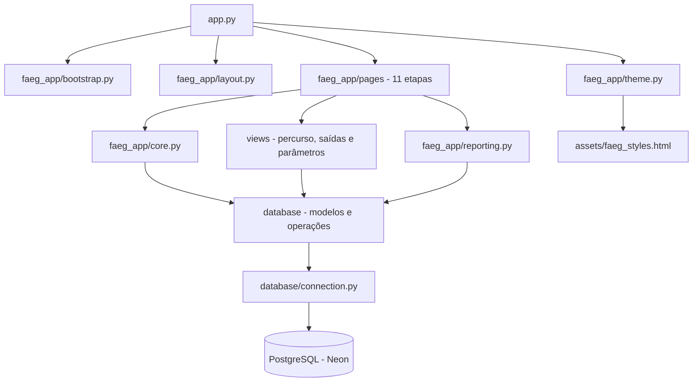

# Diagrama de componentes — arquitetura do FAEG

A aplicação é executada em um único processo Streamlit, com interface modularizada,
regras de negócio em Python e persistência no PostgreSQL (Neon) por SQLAlchemy.
Não existe uma API REST intermediária.

## Visão lógica

## Organização dos módulos Python

Os módulos de interface compartilham o contexto do Streamlit. O código de
persistência e os modelos ORM permanecem na pasta `database/`; a pasta `views/`
contém componentes operacionais reutilizáveis. Os diagramas representam a
organização do código, não serviços independentes.
