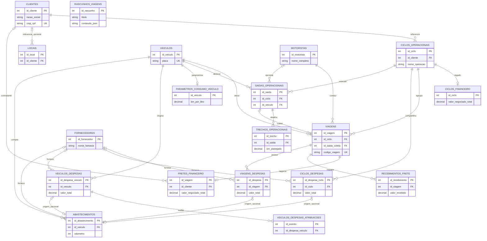

# Modelo entidade-relacionamento — 19 tabelas

O diagrama deriva das classes em [`database/models.py`](../../database/models.py), com as chaves e os relacionamentos principais. Inclui todas as 19 tabelas, embora nem todos os atributos e FKs opcionais estejam desenhados para preservar a legibilidade.

**Vínculos não desenhados:** `viagens` referencia `locais` duas vezes (coleta e entrega); os campos de origem de `abastecimentos` são FKs opcionais e alternativas; `veiculos_despesas` mantém possíveis FKs para despesas de destino após atribuição. Verificar restrições efetivas no PostgreSQL antes de afirmar exclusividade transacional completa.

As chaves primárias de `CICLOS_FINANCEIRO`, `FRETES_FINANCEIRO` e `PARAMETROS_CONSUMO_VEICULO` também participam de relacionamentos por chave estrangeira.

`RASCUNHOS_VIAGENS` é independente dos registros definitivos: um rascunho ainda não representa um frete fechado ou lançamento financeiro.
