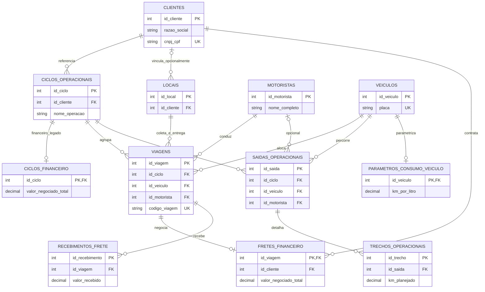
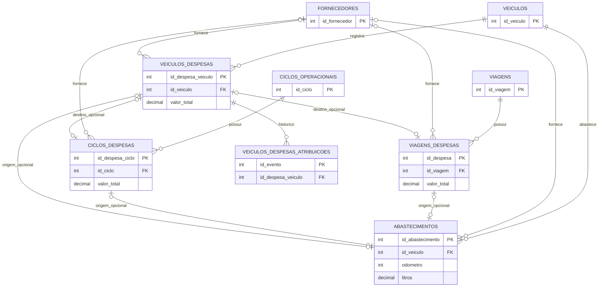

# Diagramas entidade-relacionamento — 18 tabelas SQLAlchemy

**Fonte:** [`database/models.py`](../../database/models.py), versão do repositório de 24/11/2026. As 18 tabelas são divididas em duas visões para permitir leitura no GitHub; entidades compartilhadas aparecem em ambas. As chaves e relacionamentos destacados correspondem às FKs do ORM. Os diagramas **não substituem** a verificação das restrições físicas do Neon.

## 1. Cadastros, fretes, ciclos e percurso

**Observação:** `viagens` possui duas referências obrigatórias a `locais` (`id_local_coleta` e `id_local_entrega`), representadas por uma única ligação para preservar a leitura. `saidas_operacionais.id_motorista` e `locais.id_cliente` são opcionais. `ciclos_financeiro` mantém dados legados; a negociação atual é individualizada em `fretes_financeiro`.

## 2. Despesas e abastecimentos

**Regra essencial:** cada abastecimento aponta para a despesa financeira de origem de frete, ciclo **ou** veículo. O histórico de abastecimento **não** é somado novamente à DRE. As três FKs de origem são opcionais no ORM; as validações de negócio devem impedir origens conflitantes. Atributos de cancelamento, fornecedores e atribuições estão resumidos no diagrama.
