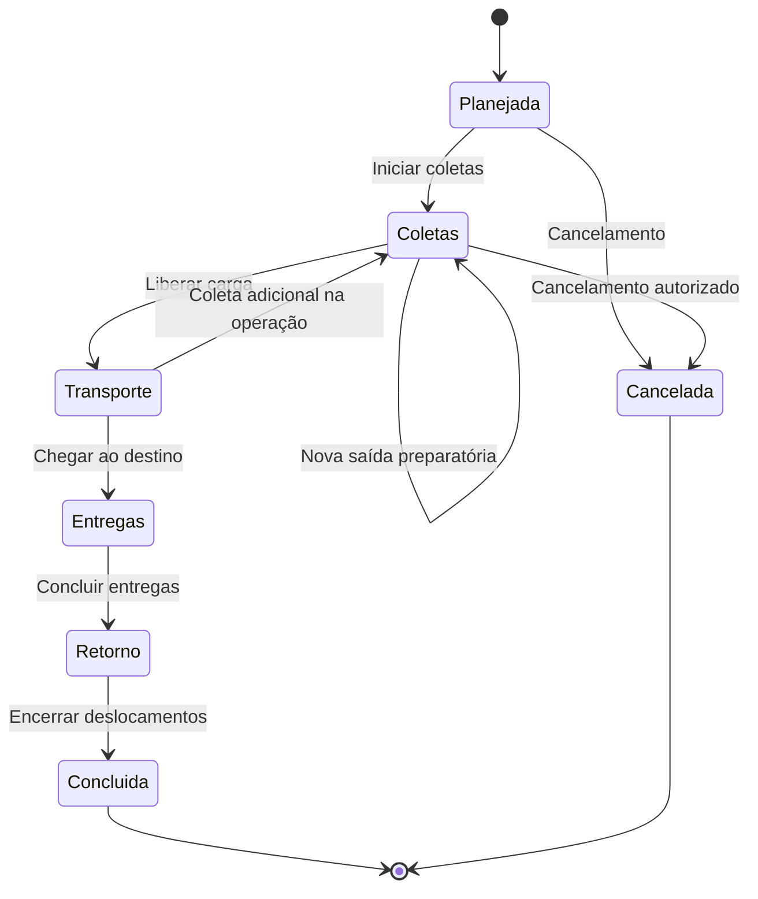
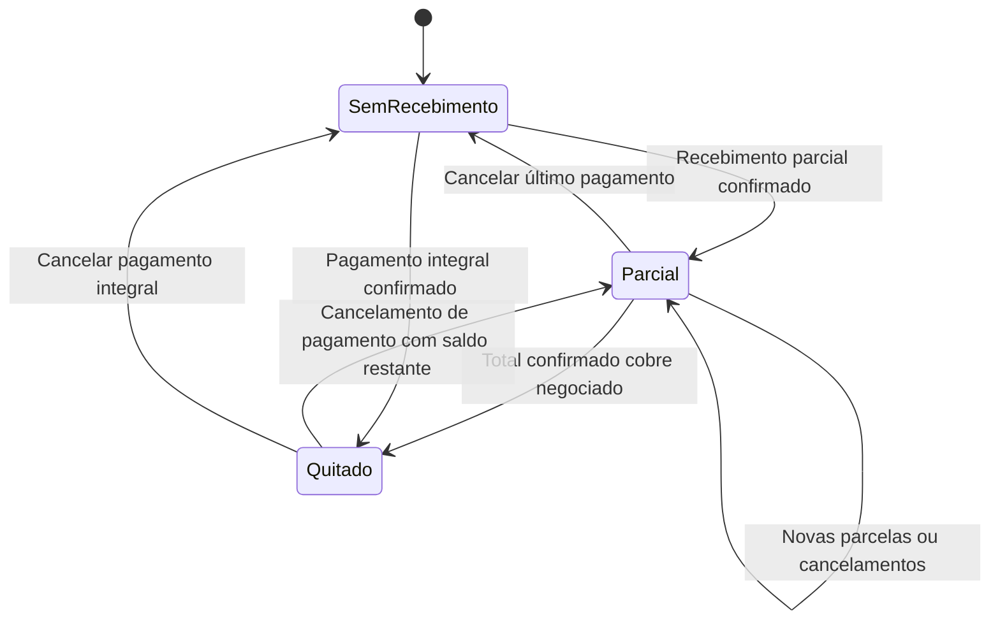

# Diagramas de estados — operação e financeiro

Acompanhamos a execução pelas situações Planejada, Em Transporte, Entregue, Concluída e Cancelada. Apuramos a situação financeira pelos recebimentos confirmados de cada frete.

## 1. Estado operacional conceitual

## 2. Estado financeiro conceitual (independente)

O estado operacional e o acompanhamento financeiro são independentes: uma entrega pode estar concluída com recebimentos ainda pendentes. Os diagramas representam transições de negócio e não uma máquina de estados integralmente automatizada.
