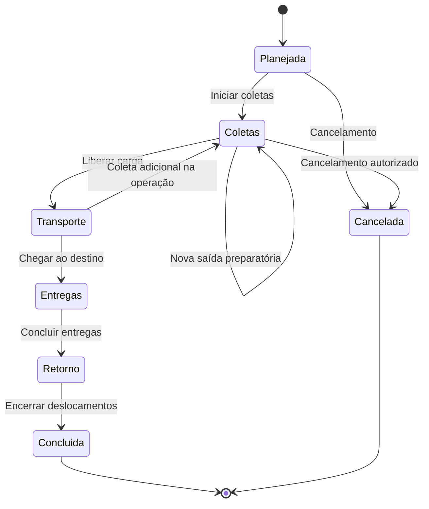
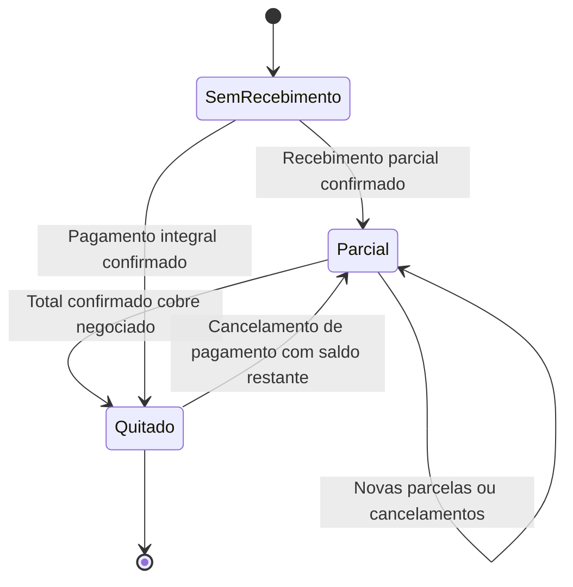

# Diagramas de estados — operação e financeiro

O modelo apresenta **estados de negócio** e ajuda a documentar transições desejadas. **Não é uma máquina de estados automática implementada integralmente em `app.py`**; as opções atuais da interface incluem rótulos como “Aguardando Adiantamento”, “Adiantamento Recebido”, “Em Transporte”, “Entregue / Aguardando Saldo”, “Quitada / Concluída” e “Cancelada”.

## 1. Estado operacional conceitual

## 2. Estado financeiro conceitual (independente)

**Cuidado:** o código controla recebimentos e saldos efetivos, mas a implantação do controle financeiro de estados, com todas essas transições e permissões, depende de validação. Uma entrega pode estar concluída mesmo com cobrança pendente.
