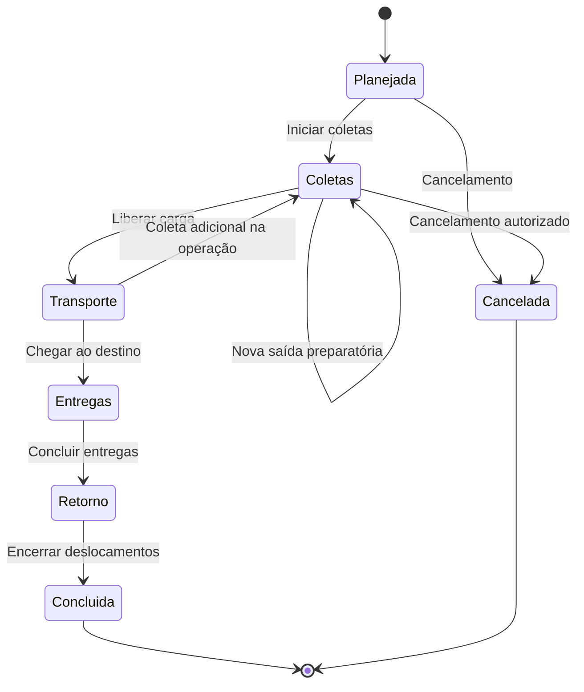
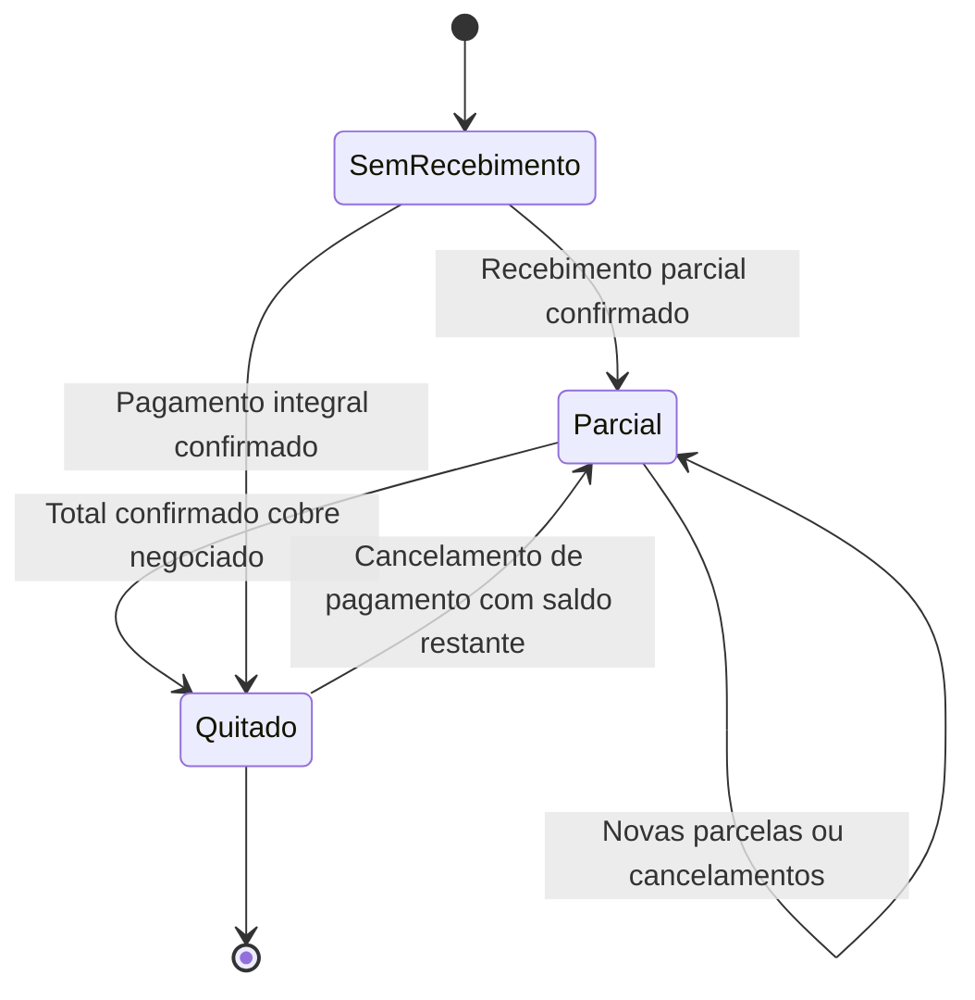

# Diagramas de estados — operação e financeiro

Os diagramas representam o fluxo de estados do negócio. As opções disponíveis na interface incluem “Aguardando Adiantamento”, “Adiantamento Recebido”, “Em Transporte”, “Entregue / Aguardando Saldo”, “Quitada / Concluída” e “Cancelada”.

## 1. Estado operacional conceitual

## 2. Estado financeiro conceitual (independente)

O estado operacional e o acompanhamento financeiro são independentes: uma entrega pode estar concluída com recebimentos ainda pendentes. Os diagramas representam transições de negócio e não uma máquina de estados integralmente automatizada.
