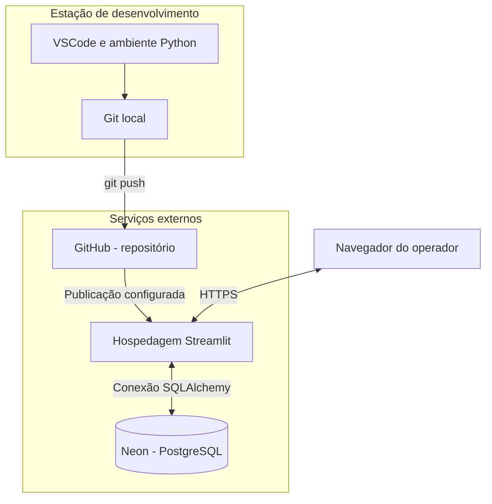

# Diagrama de implantação — desenvolvimento e execução

- O GitHub armazena o código. O provedor Streamlit executa a aplicação e utiliza a `DATABASE_URL` configurada fora do repositório.
- A publicação do código, a inicialização da aplicação e a sincronização do banco constituem etapas distintas do ciclo de implantação.
- A hospedagem e os controles de infraestrutura são configurados no ambiente de execução. A autenticação por perfil integra o planejamento técnico.
