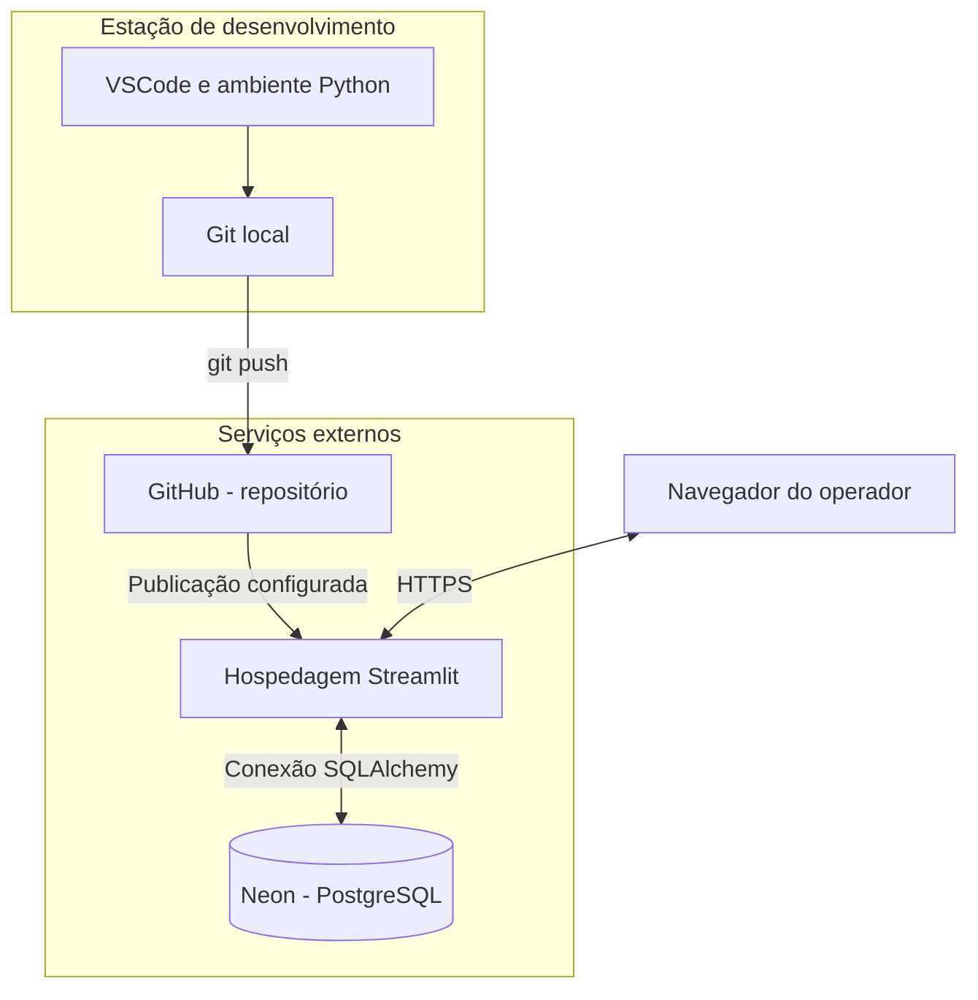

# Diagrama de implantação — desenvolvimento e execução

- O GitHub armazena o código. O provedor Streamlit executa a aplicação e utiliza a `DATABASE_URL` configurada fora do repositório.
- O `git push` **não garante** que o aplicativo iniciou ou que houve sucesso no banco. A sincronização do esquema executada na abertura também exige cautela.
- Autenticação por perfil dentro do aplicativo, configuração exata da hospedagem e controles de rede **não foram auditados** no ZIP recebido.
