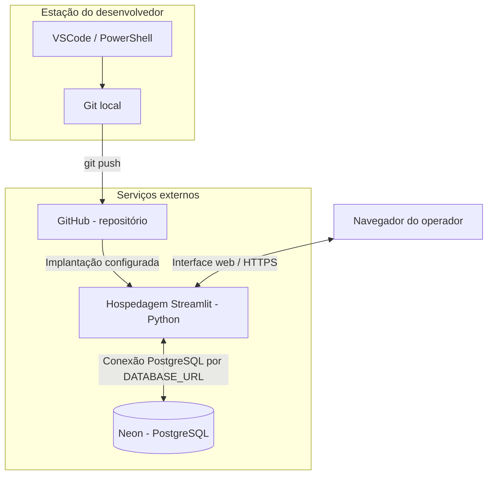

# Visão de implantação — execução e dependências

- O armazenamento de dados está no PostgreSQL; a aplicação Streamlit executa o código Python, sem API REST própria.
- Credenciais devem ser configuradas **no ambiente de hospedagem** e nunca versionadas.
- `git push` atualiza o repositório; a disponibilização e saúde do serviço dependem da implantação configurada e do início correto do aplicativo.
- A infraestrutura exata, controles de autenticação e regras de rede do provedor não foram auditados no pacote recebido.
