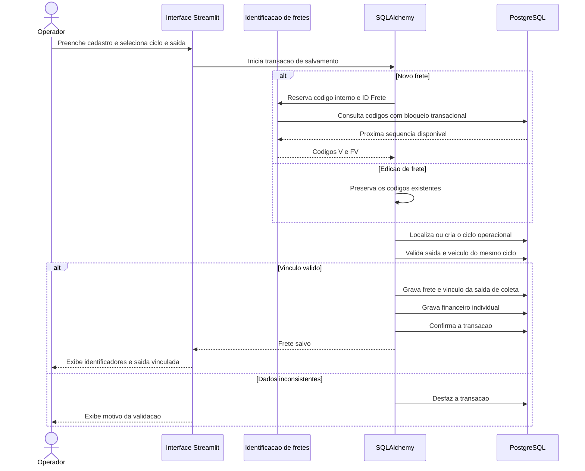
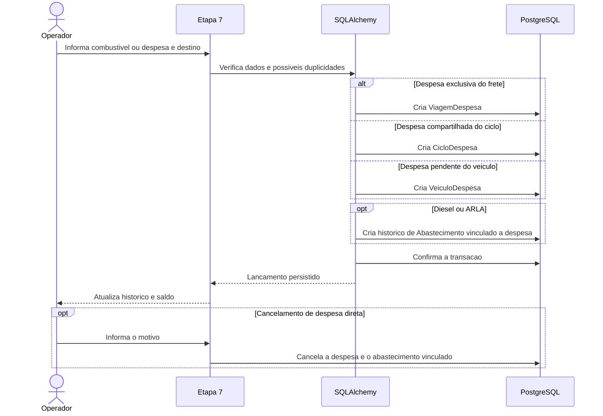
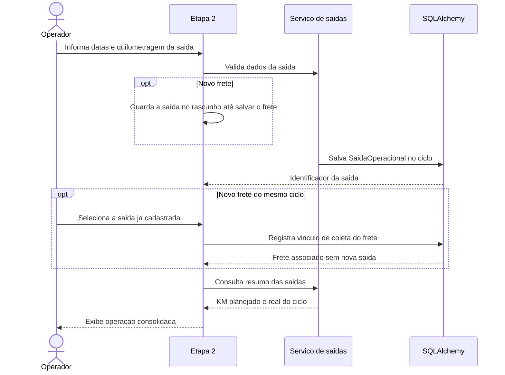

# Diagramas de sequência UML

Os fluxos representam a criação do frete, o registro das saídas e a persistência das despesas. As validações e transações estão agrupadas por responsabilidade.

## 1. Cadastro do frete e vínculo à saída

**Regra:** cada frete recebe um ID `FV` único e contínuo. Uma saída admite vários fretes, mantendo seus dados comerciais individuais. A quilometragem permanece registrada somente na saída.

## 2. Despesa e abastecimento sem duplicação

**Regra:** `abastecimentos` registra o histórico operacional da compra e não acrescenta uma segunda despesa ao DRE.

## 3. Cadastro de saída e quilometragem

**Regra:** os odômetros de saída e chegada à base determinam o KM real. Uma saída com múltiplos fretes contribui apenas uma vez para os totais físicos do ciclo.
