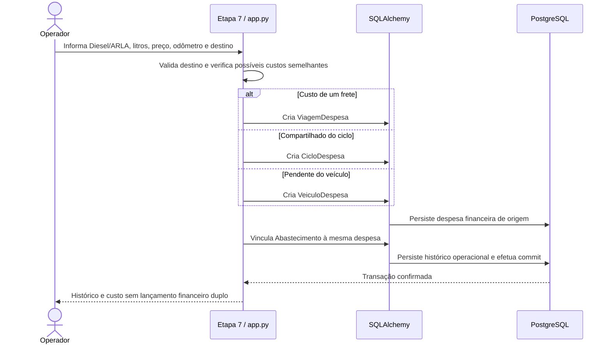
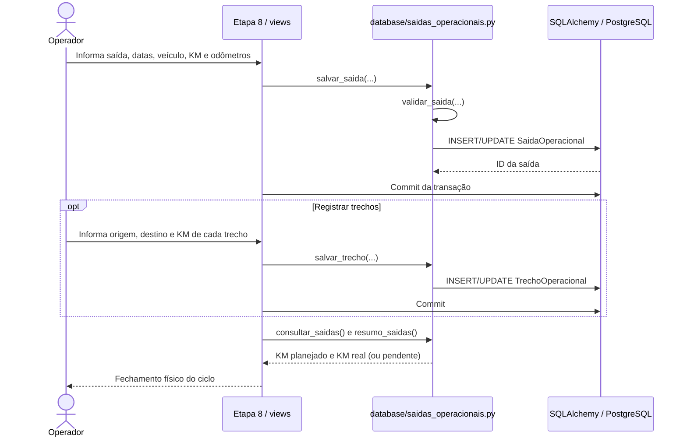

# Diagramas de sequência UML

Os diagramas descrevem **fluxos resumidos** observáveis no código. Transações, validações e mensagens foram agrupadas para legibilidade; não representam linha a linha todas as ramificações.

## 1. Cadastro de frete e vínculo a ciclo

```mermaid
sequenceDiagram
    actor Operador
    participant UI as Streamlit (app.py)
    participant ORM as SQLAlchemy / SessionLocal
    participant DB as PostgreSQL / Neon
    Operador->>UI: Preenche etapas 1 a 6 e solicita salvar
    UI->>UI: Valida ID Frete, dados e situação do ciclo
    UI->>ORM: Localiza ou cria CicloOperacional
    ORM->>DB: SELECT / INSERT de ciclo
    DB-->>ORM: ID interno do ciclo
    UI->>ORM: Cria/atualiza Viagem e FreteFinanceiro
    ORM->>DB: INSERT / UPDATE na transação
    alt Gravação confirmada
        DB-->>ORM: Commit
        ORM-->>UI: Identificadores persistidos
        UI-->>Operador: Confirmação da viagem salva
    else Violação ou erro
        DB-->>ORM: Falha/rollback
        UI-->>Operador: Aviso; não considerar salvo
    end
```

**Regra:** o ID comercial de cada frete é independente do ID interno do ciclo; pagamentos confirmados têm registros próprios, não são inferidos a partir do adiantamento previsto.

## 2. Despesa e abastecimento sem duplicação



**Regra:** a linha de `abastecimentos` é apenas uma projeção operacional da despesa original e não entra novamente na DRE.

## 3. Registrar saída e atualizar KM físico



**Regra:** se há trechos, eles prevalecem sobre o KM manual da saída; odômetro parcial impede total real definitivo.
